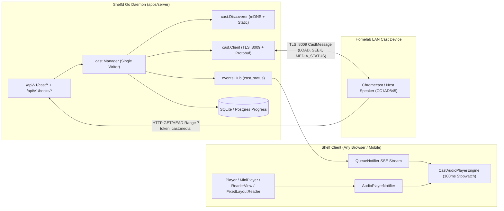
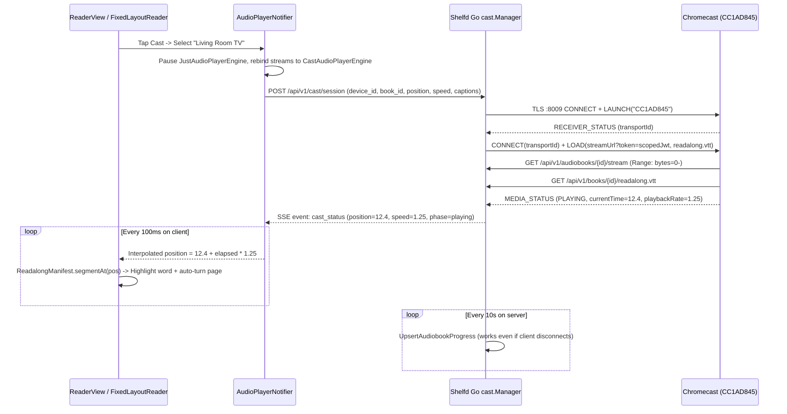

# Chromecast audiobook and read-along casting plan

Listeners and readers cast audiobooks and read-along books from Shelfd to any LAN Chromecast speaker or TV from any browser or mobile app, including over plain LAN HTTP.
A pure-Go CastV2 sender in `apps/server/internal/cast` drives Google's Default Media Receiver (`CC1AD845`) with zero Google developer registration, continuous server-side progress persistence, and optional WebVTT read-along TV captions.
A `CastAudioPlayerEngine` in `apps/app` interpolates playback clocks at 100 ms so reflowable EPUBs, fixed-layout picture books, and Document Picture-in-Picture keep word highlights and page turns synchronized with the Cast stream.
Server changes and Flutter client changes stay in separate pull requests with strict directory boundaries and an unmocked CastV2 TLS loopback receiver for automated verification.
The pull requests in order are `pr-cast-media-prep-and-tokens`, `pr-cast-server-castv2-and-api`, `pr-cast-flutter-engine-and-sync`, and `pr-cast-flutter-ui-controls`.

## How to read this

One box is one unit of work. Every box names the evidence that checks it. A nested box is a sub-step of the box above it. Check a box only when its evidence exists, a file, a log line, a screenshot, a test run, or a SHA. The body is a how-to. The appendices explain and record.

The program runs `.agents/plugins/pstack/skills/poteto-mode/playbooks/autopilot-stack.md`. Each owner stops at merge-ready on its verified branch, `pr-cast-flutter-ui-controls` pauses for the operator's UI review with screenshots and video, and the operator lands the stack bottom-up.

Tests alone are not sufficient verification. A PR is verified only when its unit, live, and perf boxes are all checked.

## Program checklist

### Arm the program

- [ ] State the protocol and this plan to the operator, then stop. Start execution only on the operator's explicit go.
- [ ] On the operator's go, copy this approved plan to `docs/chromecast-casting-plan.md` on the stack root branch and record the objective in the task list.
- [ ] Read these from trunk at program start. Re-read them at every tick.
  - [ ] `git show origin/main:.agents/plugins/pstack/skills/pstack-harness-adapter/SKILL.md`
  - [ ] `git show origin/main:.agents/plugins/pstack/skills/poteto-mode/playbooks/autopilot-stack.md`
  - [ ] `git show origin/main:.agents/plugins/pstack/skills/swarm/SKILL.md`
  - [ ] `git show origin/main:.agents/skills/verify-shelfd/SKILL.md`
  - [ ] `git show origin/main:.agents/plugins/pstack/skills/poteto-mode/playbooks/opening-a-pr.md`
  - [ ] `git show origin/main:.agents/plugins/pstack/skills/principle-model-the-domain/SKILL.md`
  - [ ] `git show origin/main:.agents/plugins/pstack/skills/principle-boundary-discipline/SKILL.md`
  - [ ] `git show origin/main:.agents/plugins/pstack/skills/principle-type-system-discipline/SKILL.md`
  - [ ] `git show origin/main:.agents/plugins/pstack/skills/principle-separate-before-serializing-shared-state/SKILL.md`
  - [ ] `git show origin/main:.agents/plugins/pstack/skills/principle-sequence-verifiable-units/SKILL.md`
  - [ ] `git show origin/main:.agents/plugins/pstack/skills/principle-build-the-lever/SKILL.md`
  - [ ] `git show origin/main:.agents/plugins/pstack/skills/principle-prove-it-works/SKILL.md`
- [ ] On the operator's go, arm the audit tick as `/loop 1h` when the host runtime supports scheduled loops, or run the audit check at each subagent wakeup boundary per `pstack-harness-adapter`. Never leave the cadence to memory.
- [ ] Use this tick prompt, verbatim. "Re-read the execution playbook from trunk. Audit the operation against it and fix drift in this tick. Probe every active lane and judge progress by side effects only. Stand down a stuck lane and dispatch its replacement now. Then post a short status message to the operator in chat only when the audit found a tracked change that no earlier status message reported, such as a PR opened, a code-ready head, a round launched or closed, a verdict, a merge, a stuck agent and the action taken, a blocker added or cleared, or a decision only the operator can make. Name every such change and nothing else. Do not repeat a table, the merged list, or an unchanged blocker. If the audit found none, end the turn with no reply text. Either way, log this tick's row in your decision trail. The row names the items reported, or none."
- [ ] On the operator's hold or stand-down, send every owner a zero-writes order at once.

### Spawn owners

- [ ] Spawn one fresh `poteto-agent` owner per PR (`Model` set to `inherit`, `Workspace` set to `inherit`) with the full lifecycle the execution playbook names.
- [ ] Follow this dependency graph. Rebase each stack child onto its parent PR's exact tip.
  - [ ] `pr-cast-media-prep-and-tokens` is first and branches from `main`.
  - [ ] `pr-cast-server-castv2-and-api` after `pr-cast-media-prep-and-tokens`.
  - [ ] `pr-cast-flutter-engine-and-sync` after `pr-cast-server-castv2-and-api`.
  - [ ] `pr-cast-flutter-ui-controls` after `pr-cast-flutter-engine-and-sync`.
- [ ] Hold the file boundaries. `pr-cast-media-prep-and-tokens` touches only `apps/server/**` and `docs/**`. `pr-cast-server-castv2-and-api` touches only `apps/server/**`, `config.example.yaml`, `docker-compose.yml`, and `.agents/skills/verify-shelfd/**`. `pr-cast-flutter-engine-and-sync` touches only `apps/app/**`. `pr-cast-flutter-ui-controls` touches only `apps/app/**` and `docs/screenshots/**`.
- [ ] Hold the review gate. `pr-cast-flutter-ui-controls` changes player, mini-player, and reader interactions. It waits for the operator's review in chat with screenshots and a video before merge.

### PR mechanics, for every PR

- [ ] Resolve the forge once. Default to `gh`; if `command -v origin` succeeds and Origin can resolve the repository, use `origin pr` for every PR operation. Record any fallback to `gh`. Never require `gt`.
- [ ] Open the PR ready, never draft, per **Opening a PR** with `gh pr create --base <base-branch>` or the resolved Origin command. A stack child targets its parent branch.
- [ ] Run `mise exec -- pnpm lint` and `mise exec -- pnpm test` once before the PR-facing push, then verify GitHub Actions CI passes with `gh pr checks --watch`. Push with hooks on.
- [ ] Inspect the diff for slop (`deslop` equivalent per `pstack-harness-adapter`) before each commit and run `.agents/plugins/pstack/skills/no-comments/SKILL.md` via `comment-sicko` before review.
- [ ] Triage every Bugbot and security-reviewer comment per `.agents/plugins/pstack/skills/poteto-mode/references/bugbot-triage.md`.
- [ ] Rebase the stack root onto current trunk and rebase each child onto its parent's exact tip before the code-ready report and babysit. Keep that merge base in fix rounds. Rebase again only at merge prep, on a `git merge-tree` conflict, on a trunk-caused CI failure, or when a parent tip advances.

### Verdict and merge, for every PR

- [ ] A full swarm runs once, at the code-ready head, per `.agents/plugins/pstack/skills/swarm/SKILL.md`. One gates lane (`mise exec -- pnpm lint && mise exec -- pnpm test && mise exec -- pnpm turbo run build:web`). The ten live lanes from the PR's **Verify, live** block. The perf lane from its **Verify, perf** block. Two audit lanes (`pstack-reviewer` and `pstack-reviewer-alt`, disclosing single-family model inheritance per `pstack-harness-adapter`) that read the diff and receipts and distrust the PR body. The root audits the receipts in the merge-ready report before the verdict.
- [ ] Judge every finding by the execution playbook's blocking rule. The verdict is clean when none blocks. A failure on trunk behavior in a lane marked `Regression lane against trunk.` is recorded against trunk and does not block the PR. A new head gets a fresh verdict, except for results that stay valid under the patch-id rule in `playbooks/shipping.md`.
- [ ] Stop at merge-ready on each verified PR per `playbooks/autopilot-stack.md`, record the verdict SHA and `git patch-id --stable`, and hand the verified stack to the operator to land bottom-up.

### Boot recipe, for every live lane

Each live lane runs against its own isolated `control-shelfd` runtime at the PR head, driven through `.agents/skills/verify-shelfd/SKILL.md`.

- [ ] `git fetch origin <head-branch> && git checkout <head SHA>` in the worktree under verification.
- [ ] Build workspace plugins (`mise exec -- pnpm build`) and launch an isolated stack with `SHELFD_VERIFY_RUN_ID="pr-<id>-w<n>" SHELFD_VERIFY_PORT=$((18080 + n)) SHELFD_VERIFY_AI_PORT=$((13000 + n)) SHELFD_VERIFY_CDP_PORT=$((19222 + n)) SHELFD_CAST_MOCK_PORT=$((19500 + n)) .agents/skills/verify-shelfd/scripts/control-shelfd launch --foreground` as a background daemon, then run `control-shelfd doctor` until healthy.
- [ ] Deliver browser input only through `.agents/skills/verify-shelfd/scripts/control-shelfd browser ...` and run read-only diagnostics through `control-shelfd api ...`, `control-shelfd state`, `control-shelfd browser console --assert-clean`, and runtime log or SQLite checks inside `$SHELFD_RUNTIME_DIR`.
- [ ] Save every screenshot to `/tmp/swarm-<pr-id>/worker-<n>/<slug>.png`, validate artifacts with `control-shelfd evidence`, stop the lane with `control-shelfd cleanup`, and return the paths with the report.

## Prepare Cast media endpoints, WebVTT tracks, and scoped tokens (pr-cast-media-prep-and-tokens)

**Depends on.** None.

**Files.**

- [ ] Create `docs/chromecast-casting-plan.md`.
- [ ] Create `docs/decisions/0024-server-side-castv2-sender.md`.
- [ ] Edit `docs/decisions/index.md`.
- [ ] Edit `apps/server/internal/api/jwt.go`.
- [ ] Edit `apps/server/internal/api/middleware.go`.
- [ ] Edit `apps/server/internal/api/router.go`.
- [ ] Edit `apps/server/internal/api/books.go`.
- [ ] Edit `apps/server/internal/api/audiobooks.go`.
- [ ] Edit `apps/server/internal/epub/epub.go`.
- [ ] Edit `apps/server/internal/epub/content.go`.
- [ ] Create `apps/server/internal/api/cast_media_test.go`.

**Build.**

- [ ] Add `GenerateCastMediaJWT(userID, username, bookID, secret string, duration time.Duration)` in `apps/server/internal/api/jwt.go` issuing HS256 tokens with scope `cast:media:<bookID>`.
- [ ] Add `CastScopeAllowsRequest(scopes []string, method, path string) bool` in `apps/server/internal/api/middleware.go` and enforce scope validation in `AuthMiddleware` whenever `len(jwtClaims.Scopes) > 0`, restricting `cast:media:<bookID>` to `GET` and `HEAD` on `/api/v1/audiobooks/<bookID>/stream`, `/api/v1/books/<bookID>/audio`, `/api/v1/books/<bookID>/files/*/stream`, `/api/v1/books/<bookID>/assets/*`, `/api/v1/books/<bookID>/cover`, and `/api/v1/books/<bookID>/readalong.vtt`.
- [ ] Register `HEAD /api/v1/books/{id}/cover`, `HEAD /api/v1/books/{id}/assets/{path...}`, `GET /api/v1/books/{id}/readalong.vtt`, and `HEAD /api/v1/books/{id}/readalong.vtt` in `apps/server/internal/api/router.go`.
- [ ] Update `BookHandler.GetBookCover` and `BookHandler.GetBookAsset` in `apps/server/internal/api/books.go` to allow `HEAD` and serve bytes via `http.ServeContent` with `Accept-Ranges: bytes`.
- [ ] Add `Reader.ExtractMediaAsset` in `apps/server/internal/epub/content.go` using a 512 MB ceiling instead of `readZipFile`'s 15 MB XHTML limit in `apps/server/internal/epub/epub.go`, and wire `BookHandler.GetBookAsset` and `AudiobookHandler.StreamAudio` to use it for audio entries so embedded EPUB audio tracks above 15 MB never truncate.
- [ ] Add `BookHandler.GetBookReadalongVTT` in `apps/server/internal/api/books.go` rendering read-along segments as `text/vtt; charset=utf-8` cues, using global timestamps by default and track-local `ClipBegin` to `ClipEnd` timestamps when `?track=<audio_src>` is supplied for multi-track SMIL EPUBs.
- [ ] Record `ADR-0024` in `docs/decisions/0024-server-side-castv2-sender.md` and append its row to `docs/decisions/index.md`.

**You see.**

- [ ] `curl -I "<server>/api/v1/books/<peterRabbitId>/cover?token=<castJwt>"` and `curl -I -H "Range: bytes=0-63" "<server>/api/v1/books/<peterRabbitId>/readalong.vtt?token=<castJwt>"` return `200 OK` with `Accept-Ranges: bytes` and `Content-Type: text/vtt; charset=utf-8`, while `POST /api/v1/audiobooks/<peterRabbitId>/progress?token=<castJwt>` returns `403 Forbidden`.

**Verify, unit.** Tests alone are not sufficient verification. A PR is verified only when its unit, live, and perf boxes are all checked.

- [ ] `apps/server/internal/api/cast_media_test.go` verifies `GenerateCastMediaJWT`, `CastScopeAllowsRequest` allow and deny matrices (wrong book ID, `POST`/`DELETE` rejection, `/api/v1/books` list rejection), `HEAD` and `206 Partial Content` range responses on `GetBookCover` and `GetBookAsset`, `> 15 MB` embedded EPUB audio streaming without truncation, and `GetBookReadalongVTT` cue formatting for both global and `?track=` timelines. Run `(cd apps/server && mise exec -- go test -tags sqlite_fts5 -ldflags="-linkmode=external" -v ./internal/api/... ./internal/epub/...)`.

**Verify, live.** Tests alone are not sufficient verification. A PR is verified only when its unit, live, and perf boxes are all checked. Ten lanes on `inherit` at the PR head, per the boot recipe.

- [ ] Lane 1. Regression lane against trunk. Authenticate in the browser and stream `The Tale of Peter Rabbit` in `/books/<id>/listen` and `/books/<id>/read` on trunk and head. Save `/tmp/swarm-pr-cast-media-prep-and-tokens/worker-1/regression-playback.png`. Pass when audio plays, SMIL highlights advance, and `browser console --assert-clean` passes.
- [ ] Lane 2. Issue `HEAD` and `Range: bytes=0-255` `GET` against `/api/v1/books/<peterRabbitId>/cover` with a `cast:media:<peterRabbitId>` token and render cover preview in Chromium. Save `/tmp/swarm-pr-cast-media-prep-and-tokens/worker-2/cover-head-range.png`. Pass when `HEAD` returns `200` and `Range` `GET` returns `206` with exact `Content-Range`.
- [ ] Lane 3. Issue `HEAD` and `Range: bytes=0-127` `GET` against `/api/v1/books/<peterRabbitId>/assets/OEBPS/page01.xhtml` with a `cast:media:<peterRabbitId>` token. Save `/tmp/swarm-pr-cast-media-prep-and-tokens/worker-3/asset-head-range.png`. Pass when `HEAD` returns `200` instead of `405` and `Range` `GET` returns `206`.
- [ ] Lane 4. Fetch `GET /api/v1/books/<peterRabbitId>/readalong.vtt` and render the WebVTT cues inside an HTML5 `<audio>` + `<track kind="subtitles" default>` harness page in Chromium. Save `/tmp/swarm-pr-cast-media-prep-and-tokens/worker-4/webvtt-cues.png`. Pass when `WEBVTT` header and 10 ordered cues (`00:00:00.000 --> 00:00:09.000` span) parse with `track.cues.length === 10`.
- [ ] Lane 5. Upload a multi-track SMIL EPUB with two chapter MP3 assets and fetch `/readalong.vtt?track=OEBPS/audio/ch2.mp3`. Save `/tmp/swarm-pr-cast-media-prep-and-tokens/worker-5/webvtt-per-track.png`. Pass when returned cues contain only `ch2.mp3` segments shifted to track-local `ClipBegin` and `ClipEnd` timestamps.
- [ ] Lane 6. Upload an EPUB containing an 18 MB uncompressed WAV/MP3 media asset and stream it via `/api/v1/books/<id>/assets/...` with byte ranges near byte `17000000`. Save `/tmp/swarm-pr-cast-media-prep-and-tokens/worker-6/large-epub-audio.png`. Pass when full `Content-Length` exceeds `15728640` bytes and tail byte range matches SHA-256 fixture bytes.
- [ ] Lane 7. Probe `cast:media:<peterRabbitId>` token against `GET /api/v1/books/<duneId>/cover` and `GET /api/v1/books`. Save `/tmp/swarm-pr-cast-media-prep-and-tokens/worker-7/scope-cross-book-deny.png`. Pass when both requests return `403 Forbidden`.
- [ ] Lane 8. Probe `cast:media:<peterRabbitId>` token against `POST /api/v1/audiobooks/<peterRabbitId>/progress` and `DELETE /api/v1/books/<peterRabbitId>/bookmarks/test`. Save `/tmp/swarm-pr-cast-media-prep-and-tokens/worker-8/scope-mutation-deny.png`. Pass when all non-`GET`/`HEAD` requests return `403 Forbidden`.
- [ ] Lane 9. Verify CORS preflight `OPTIONS` and `GET` headers on `/api/v1/books/<peterRabbitId>/readalong.vtt` and `/api/v1/audiobooks/<peterRabbitId>/stream` from a cross-origin receiver origin (`https://www.gstatic.com`). Save `/tmp/swarm-pr-cast-media-prep-and-tokens/worker-9/cors-receiver-origin.png`. Pass when `Access-Control-Allow-Origin: *` is present and zero CORS errors appear in Chromium console.
- [ ] Lane 10. Run `control-shelfd doctor` after all media and WebVTT probes. Save `/tmp/swarm-pr-cast-media-prep-and-tokens/worker-10/sidecar-integrity.png`. Pass when Audiobookshelf `.metadata.json` and `desc.txt` SHA-256 checksums remain unchanged.

**Verify, perf.** Tests alone are not sufficient verification. A PR is verified only when its unit, live, and perf boxes are all checked.

- [ ] Metric. Latency in milliseconds and heap bytes allocated per request for `HEAD /api/v1/books/{id}/cover`, `Range: bytes=0-4095` `GET /api/v1/audiobooks/{id}/stream`, and `GET /api/v1/books/{id}/readalong.vtt` (1000 segments).
- [ ] Probe. Run `mise exec -- go test -tags sqlite_fts5 -bench=BenchmarkCastMediaEndpoints -benchmem -count=5 ./internal/api` interleaved at trunk (`StreamAudio` range baseline) and head (`StreamAudio` range plus `GetBookReadalongVTT` and scoped JWT middleware).
- [ ] Baseline. Record trunk `BenchmarkCastMediaEndpoints/StreamAudioRange` ns/op and B/op first.
- [ ] Rule. `StreamAudioRange` p95 latency at head stays within 5% of trunk, and 1000-segment `GetBookReadalongVTT` completes under 5 ms per request with under 512 KB allocated.

**Review gate.** None. `pr-cast-media-prep-and-tokens` is not review-gated.

**Merge.**

- [ ] Root's clean verdict at the exact head SHA.
- [ ] Bugbot triage done.
- [ ] Rebased onto current trunk after the verdict, patch-id unchanged.
- [ ] Stop at merge-ready on the stack root branch per `playbooks/autopilot-stack.md`.

## Build Go CastV2 sender, discovery, session manager, and REST/SSE APIs (pr-cast-server-castv2-and-api)

**Depends on.** `pr-cast-media-prep-and-tokens`.

**Files.**

- [ ] Create `apps/server/internal/cast/wire.go`.
- [ ] Create `apps/server/internal/cast/types.go`.
- [ ] Create `apps/server/internal/cast/discovery.go`.
- [ ] Create `apps/server/internal/cast/client.go`.
- [ ] Create `apps/server/internal/cast/manager.go`.
- [ ] Create `apps/server/internal/cast/casttest/receiver.go`.
- [ ] Create `apps/server/internal/cast/cast_test.go`.
- [ ] Edit `apps/server/internal/config/config.go`.
- [ ] Edit `apps/server/internal/config/config_test.go`.
- [ ] Edit `apps/server/internal/events/hub.go`.
- [ ] Create `apps/server/internal/api/cast.go`.
- [ ] Create `apps/server/internal/api/cast_test.go`.
- [ ] Edit `apps/server/internal/api/router.go`.
- [ ] Edit `apps/server/cmd/server/main.go`.
- [ ] Edit `config.example.yaml`.
- [ ] Edit `docker-compose.yml`.
- [ ] Create `.agents/skills/verify-shelfd/scripts/mock-cast-receiver.mjs`.
- [ ] Edit `.agents/skills/verify-shelfd/scripts/control-shelfd`.

**Build.**

- [ ] Implement `CastMessage` binary Protobuf wire codec (`protocol_version`, `source_id`, `destination_id`, `namespace`, `payload_type`, `payload_utf8`, `payload_binary`) with 4-byte big-endian length framing and a 64 KB packet ceiling in `apps/server/internal/cast/wire.go` with zero external module additions to `go.mod`.
- [ ] Define domain types in `apps/server/internal/cast/types.go` (`Device`, `DeviceCapability`, `SessionPhase` state machine `idle`, `connecting`, `launching`, `loading`, `playing`, `paused`, `buffering`, `error`, `SessionSnapshot`, and `QueueTrackOffset` mapping multi-track SMIL `queueItemId` items to book-global `GlobalBegin` offsets).
- [ ] Implement `_googlecast._tcp.local` mDNS discovery in `apps/server/internal/cast/discovery.go` using `golang.org/x/net/dns/dnsmessage` and `golang.org/x/net/ipv4` (parsing TXT `id`, `fn`, `md`, `ca` bitmask for video vs audio-only receivers) merged with configured static devices.
- [ ] Implement `cast.Client` in `apps/server/internal/cast/client.go` over `crypto/tls` (`MinVersion: tls.VersionTLS12`, `InsecureSkipVerify: true` for Chromecast peer certs on port `8009`) handling `CONNECT`/`CLOSE` (`urn:x-cast:com.google.cast.tp.connection`), 5-second `PING`/`PONG` keepalives with 15-second timeout (`urn:x-cast:com.google.cast.tp.heartbeat`), `LAUNCH` (`CC1AD845`) and `SET_VOLUME` (`urn:x-cast:com.google.cast.receiver`), and `LOAD`, `QUEUE_LOAD`, `PLAY`, `PAUSE`, `SEEK`, `SET_PLAYBACK_RATE`, `EDIT_TRACKS_INFO`, `STOP`, and `GET_STATUS` (`urn:x-cast:com.google.cast.media`).
- [ ] Build `casttest.Receiver` in `apps/server/internal/cast/casttest/receiver.go` speaking real TLS + Protobuf `CastMessage` frames on a loopback port and issuing real HTTP `HEAD` and byte-range `GET` checks against every `contentId`, cover `images[0].url`, and WebVTT `trackContentId` loaded onto it, plus `.agents/skills/verify-shelfd/scripts/mock-cast-receiver.mjs` wired into `control-shelfd` via `SHELFD_CAST_STATIC_DEVICES` when `SHELFD_CAST_MOCK_PORT` is set.
- [ ] Implement `cast.Manager` in `apps/server/internal/cast/manager.go` resolving LAN base URLs (`cfg.Cast.LANBaseURL` override or outbound UDP route IP to the target device + `cfg.Server.Port`), minting 12-hour `GenerateCastMediaJWT` URLs, building single-stream `LOAD` (with `AUDIOBOOK_CONTAINER` metadata, cover image, and WebVTT `tracks` when captions are requested on video-capable devices) or multi-track SMIL `QUEUE_LOAD` (seeking across queue items by global timestamp), polling `GET_STATUS` every 2 seconds while active, broadcasting `events.EventCastStatus` and `events.EventCastDevices` (`apps/server/internal/events/hub.go`), and persisting `repo.UpsertAudiobookProgress` every 10 seconds and on pause, seek, stop, and `IDLE`/`FINISHED`.
- [ ] Add `CastConfig` (`Enabled`, `LANBaseURL`, `StaticDevices`) and env overrides (`SHELFD_CAST_ENABLED`, `SHELFD_CAST_LAN_BASE_URL`, `SHELFD_CAST_STATIC_DEVICES`) in `apps/server/internal/config/config.go`, document them in `config.example.yaml` and `docker-compose.yml` (with host-network mDNS and bridge static-device guidance), and wire `cast.Manager` lifecycle (`Start` and graceful `Close` on `SIGTERM`) in `apps/server/cmd/server/main.go`.
- [ ] Mount protected REST endpoints in `apps/server/internal/api/cast.go` and `apps/server/internal/api/router.go` for `GET /api/v1/cast/devices`, `GET /api/v1/cast/session`, `POST /api/v1/cast/session`, `POST /api/v1/cast/session/control`, and `DELETE /api/v1/cast/session`.

**You see.**

- [ ] Server log emits `cast: session started device="Living Room TV" app_id="CC1AD845" book_id="<id>"`, `GET /api/v1/cast/session` returns `"phase":"playing"` with advancing `position_seconds`, `/api/v1/queue/events` emits `event: cast_status`, and `/api/v1/audiobooks/<id>/progress` updates in SQLite with zero browser tabs open.

**Verify, unit.** Tests alone are not sufficient verification. A PR is verified only when its unit, live, and perf boxes are all checked.

- [ ] `apps/server/internal/cast/cast_test.go`, `apps/server/internal/config/config_test.go`, and `apps/server/internal/api/cast_test.go` verify `CastMessage` wire round-trips, oversized packet rejection, mDNS DNS-SD response parsing, `cast.Client` handshake/heartbeat/timeout against `casttest.Receiver`, single-stream `LOAD` + WebVTT `EDIT_TRACKS_INFO`, multi-track SMIL `QUEUE_LOAD` + cross-track global seeking, SSE `cast_status` broadcasts, and server-side SQLite `UpsertAudiobookProgress` persistence. Run `(cd apps/server && mise exec -- go test -tags sqlite_fts5 -ldflags="-linkmode=external" -race -v ./internal/cast/... ./internal/config/... ./internal/api/...)`.

**Verify, live.** Tests alone are not sufficient verification. A PR is verified only when its unit, live, and perf boxes are all checked. Ten lanes on `inherit` at the PR head, per the boot recipe.

- [ ] Lane 1. Regression lane against trunk. Run `control-shelfd doctor`, catalog browse, and local audiobook streaming on trunk and head. Save `/tmp/swarm-pr-cast-server-castv2-and-api/worker-1/regression-catalog-audio.png`. Pass when all existing API/UI checks pass and `GET /api/v1/cast/devices` returns the configured mock Cast speakers and TV on head.
- [ ] Lane 2. Discover devices via `control-shelfd api GET /api/v1/cast/devices?refresh=true` with both a video-capable mock TV and an audio-only mock speaker active. Save `/tmp/swarm-pr-cast-server-castv2-and-api/worker-2/device-discovery.png`. Pass when both devices appear with accurate `id`, `name`, `model`, and `has_video` capabilities.
- [ ] Lane 3. Start an audiobook Cast session via `POST /api/v1/cast/session` for `The Tale of Peter Rabbit` at `position_seconds: 2.0` and `speed: 1.25`. Save `/tmp/swarm-pr-cast-server-castv2-and-api/worker-3/session-start-load.png`. Pass when `mock-cast-receiver` records TLS `CONNECT`, `LAUNCH` `CC1AD845`, `LOAD` with `currentTime: 2`, `SET_PLAYBACK_RATE` `1.25`, and HTTP `206` audio + `200` cover fetches.
- [ ] Lane 4. Exercise `POST /api/v1/cast/session/control` for `pause`, `play`, `seek` (`6.5s`), `speed` (`1.5x`), and `volume` (`0.4`). Save `/tmp/swarm-pr-cast-server-castv2-and-api/worker-4/transport-controls.png`. Pass when `GET /api/v1/cast/session` reflects each state transition and volume level.
- [ ] Lane 5. Enable WebVTT TV captions (`captions_enabled: true`) on the video-capable mock TV and verify track activation, then cast to the audio-only speaker and verify WebVTT tracks are omitted. Save `/tmp/swarm-pr-cast-server-castv2-and-api/worker-5/webvtt-tv-vs-speaker.png`. Pass when the TV receiver fetches `/readalong.vtt` with `activeTrackIds: [1]` and the audio-only speaker receives `tracks: []`.
- [ ] Lane 6. Upload a 2-chapter multi-track SMIL EPUB (`ch1.mp3` 4s + `ch2.mp3` 5s), start casting, and seek to global `6.0s`. Save `/tmp/swarm-pr-cast-server-castv2-and-api/worker-6/multitrack-smil-queue.png`. Pass when `mock-cast-receiver` receives `QUEUE_LOAD` with 2 items, jumps to item 2 at track-local `2.0s`, and `GET /api/v1/cast/session` reports global `position_seconds >= 6.0`.
- [ ] Lane 7. Subscribe to `/api/v1/queue/events` over SSE while Cast playback advances and pauses. Save `/tmp/swarm-pr-cast-server-castv2-and-api/worker-7/sse-cast-events.png`. Pass when `event: cast_status` frames arrive with monotonic timestamps and matching `session_id`.
- [ ] Lane 8. Close all client connections while Cast playback runs for 4 seconds, then `DELETE /api/v1/cast/session` and query `GET /api/v1/audiobooks/<id>/progress`. Save `/tmp/swarm-pr-cast-server-castv2-and-api/worker-8/headless-progress-sync.png`. Pass when persisted `position_seconds` in SQLite reflects the final Cast playhead.
- [ ] Lane 9. Kill `mock-cast-receiver` mid-playback to simulate unplugging a Chromecast on the LAN. Save `/tmp/swarm-pr-cast-server-castv2-and-api/worker-9/receiver-drop-recovery.png`. Pass when `cast.Manager` detects the broken TLS socket / missed `PONG`, flushes the last known progress to SQLite, transitions session phase to `error`/`idle` without goroutine leaks or panics, and broadcasts `cast_status`.
- [ ] Lane 10. Test invalid device ID (`404`), unauthenticated `/api/v1/cast/*` requests (`401`), and `cast:media:<bookID>` token reuse against `/api/v1/cast/session` (`403`). Save `/tmp/swarm-pr-cast-server-castv2-and-api/worker-10/cast-auth-guards.png`. Pass when all boundary status codes match and `control-shelfd doctor` passes.

**Verify, perf.** Tests alone are not sufficient verification. A PR is verified only when its unit, live, and perf boxes are all checked.

- [ ] Metric. Idle daemon RSS delta in megabytes and CastV2 `CastMessage` round-trip control latency (`POST /api/v1/cast/session/control` to SSE `cast_status` emission) in milliseconds against loopback `casttest.Receiver`.
- [ ] Probe. Measure `/proc/<shelfd-pid>/status` `VmRSS` after 30s idle at trunk and head, and run `mise exec -- go test -tags sqlite_fts5 -bench=BenchmarkCastControlRoundTrip -benchmem -count=5 ./internal/api` at head.
- [ ] Baseline. Record trunk idle `shelfd` `VmRSS` in MB first (0 ms Cast control baseline on trunk, which lacks CastV2).
- [ ] Rule. Idle `VmRSS` stays under the 50 MB daemon ceiling and grows by less than 4 MB over trunk, and p95 loopback Cast control round-trip completes under 15 ms with zero leaked goroutines after session teardown.

**Review gate.** None. `pr-cast-server-castv2-and-api` is not review-gated.

**Merge.**

- [ ] Root's clean verdict at the exact head SHA.
- [ ] Bugbot triage done.
- [ ] Rebased onto `pr-cast-media-prep-and-tokens` tip after the verdict, patch-id unchanged.
- [ ] Stop at merge-ready on the stacked branch per `playbooks/autopilot-stack.md`.

## Add Flutter CastAudioPlayerEngine, clock interpolation, and output handoff (pr-cast-flutter-engine-and-sync)

**Depends on.** `pr-cast-server-castv2-and-api`.

**Files.**

- [ ] Create `apps/app/lib/data/models/cast_models.dart`.
- [ ] Edit `apps/app/lib/data/services/api_service.dart`.
- [ ] Create `apps/app/lib/ui/state/cast_audio_player_engine.dart`.
- [ ] Create `apps/app/lib/ui/state/cast_provider.dart`.
- [ ] Edit `apps/app/lib/ui/state/audio_player_state.dart`.
- [ ] Edit `apps/app/lib/ui/state/audio_player_provider.dart`.
- [ ] Edit `apps/app/lib/ui/state/providers.dart`.
- [ ] Create `apps/app/test/cast_audio_engine_test.dart`.

**Build.**

- [ ] Define `CastDevice`, `CastSessionPhase`, and `CastSessionSnapshot` immutable value types in `apps/app/lib/data/models/cast_models.dart`.
- [ ] Add `getCastDevices`, `getCastSession`, `startCastSession`, `controlCastSession`, and `stopCastSession` to `ApiService`, plus `CastStatusEvent` and `CastDevicesEvent` variants in `ShelfdEvent` (`apps/app/lib/data/services/api_service.dart`) routed from `QueueNotifier._connectStream` (`apps/app/lib/ui/state/providers.dart`).
- [ ] Implement `CastAudioPlayerEngine` (`apps/app/lib/ui/state/cast_audio_player_engine.dart`) conforming to `AudioPlayerEngine`. It forwards `play`, `pause`, `seek`, `setSpeed`, `setVolume`, and `stop` to `ApiService`, ingests SSE `CastSessionSnapshot` anchors, and emits 100 ms `positionStream` ticks using a monotonic `Stopwatch` (`anchorPos + elapsed * speed` clamped to `duration`, absorbing sub-250 ms drift smoothly and snapping immediately on seeks or state changes).
- [ ] Implement `CastNotifier` (`apps/app/lib/ui/state/cast_provider.dart`) with `_isDisposed` async guards. It watches `queueProvider` (keeping SSE live even on direct deep links to `/books/:id/listen` and `/books/:id/read` outside `AppShell`), fetches initial `/api/v1/cast/devices` and `/api/v1/cast/session`, reconciles every 5 seconds as an SSE fallback, and orchestrates `connectToDevice`, `disconnectToLocal`, `setCastVolume`, and `setCaptionsEnabled`.
- [ ] Extend `AudioPlayerNotifier` (`apps/app/lib/ui/state/audio_player_provider.dart`) and `AudioPlayerState` (`apps/app/lib/ui/state/audio_player_state.dart`) with `activeCastDevice`. Add `handoffToCast(CastDevice, {bool captionsEnabled})` and `handoffToLocal()` so the notifier pauses the outgoing engine, rebinds `_posSub`, `_durSub`, and `_statusSub` to the active engine without resetting `book`, `chapters`, `playbackMode`, or `sleepTimerRemaining`, rehydrates an already-running server Cast session on app launch, and skips client HTTP `_syncProgressToServer` POSTs while casting so server-side Cast persistence has exclusive write ownership.

**You see.**

- [ ] Starting a Cast session while `The Tale of Peter Rabbit` is open in `/books/<id>/read` pauses local browser audio, streams audio on the Cast receiver, and keeps SMIL word highlights (`#w1` through `#w10`), fixed-layout spread turns, and Document PiP snapshots advancing smoothly at 100 ms resolution.

**Verify, unit.** Tests alone are not sufficient verification. A PR is verified only when its unit, live, and perf boxes are all checked.

- [ ] `apps/app/test/cast_audio_engine_test.dart` verifies `CastModels` JSON parsing, `CastAudioPlayerEngine` 100 ms monotonic interpolation at `1.0x` and `1.5x`, drift clamping, seek snapping, `AudioPlayerNotifier` mid-book `handoffToCast` and `handoffToLocal` preserving `AudioPlaybackMode.readalong` and sleep timers, suppression of redundant client HTTP progress POSTs while casting, session rehydration on startup, and `ReadalongManifest.segmentAt` word progression under Cast ticks. Run `(cd apps/app && mise exec -- flutter analyze --no-fatal-infos --no-fatal-warnings && mise exec -- flutter test)`.

**Verify, live.** Tests alone are not sufficient verification. A PR is verified only when its unit, live, and perf boxes are all checked. Ten lanes on `inherit` at the PR head, per the boot recipe.

- [ ] Lane 1. Regression lane against trunk. Play `The Tale of Peter Rabbit` locally in `/books/<id>/listen` and switch to `/books/<id>/read` on trunk and head with no Cast session active. Save `/tmp/swarm-pr-cast-flutter-engine-and-sync/worker-1/local-playback-regression.png`. Pass when local `JustAudioPlayerEngine` playback, scrubber, and SMIL highlights behave identically with clean console.
- [ ] Lane 2. Start a Cast session via `POST /api/v1/cast/session` while the browser is open on `/books/<id>/listen` and observe automatic client session adoption via SSE. Save `/tmp/swarm-pr-cast-flutter-engine-and-sync/worker-2/sse-session-attach.png`. Pass when the player scrubber advances in lockstep with `GET /api/v1/cast/session` while browser `<audio>` elements remain silent/paused.
- [ ] Lane 3. Open `/books/<id>/read` on `The Tale of Peter Rabbit` during active Cast playback across the 4.0-second page-1 to page-2 boundary. Save `/tmp/swarm-pr-cast-flutter-engine-and-sync/worker-3/fixed-layout-cast-readalong.png`. Pass when `control-shelfd browser iframes --assert-normalized` passes, SMIL active classes highlight words on page 1, and `FixedLayoutReader` auto-turns to page 2 after `4.0s`.
- [ ] Lane 4. Upload a reflowable read-along book, start Cast playback, and open `/books/<id>/read`. Save `/tmp/swarm-pr-cast-flutter-engine-and-sync/worker-4/reflowable-cast-readalong.png`. Pass when paragraph highlights advance and chapter auto-turn loads chapter 2 across the chapter boundary.
- [ ] Lane 5. Click Play/Pause, Skip +30s / -10s, and Speed `1.5x` in `AudiobookPlayerView` while casting. Save `/tmp/swarm-pr-cast-flutter-engine-and-sync/worker-5/player-controls-to-cast.png`. Pass when `GET /api/v1/cast/session` reflects paused/playing state, seeked timestamp, and `1.5` speed within 250 ms.
- [ ] Lane 6. Select chapter 2 from `ChapterDrawerSheet` while casting. Save `/tmp/swarm-pr-cast-flutter-engine-and-sync/worker-6/chapter-jump-cast.png`. Pass when `mock-cast-receiver` receives `SEEK` to chapter 2's `startOffsetSec` and active chapter equalizer updates.
- [ ] Lane 7. Deep-link directly to `http://127.0.0.1:<port>/books/<peterRabbitId>/read` in a fresh browser tab while a Cast session is already playing on the server. Save `/tmp/swarm-pr-cast-flutter-engine-and-sync/worker-7/deeplink-outside-appshell-sse.png`. Pass when `CastNotifier` mounts `queueProvider`, attaches to the live Cast session, and highlights active SMIL words without visiting `/books` first.
- [ ] Lane 8. Reload the browser tab mid-Cast playback and verify Cast playback continues uninterrupted on `mock-cast-receiver`. Save `/tmp/swarm-pr-cast-flutter-engine-and-sync/worker-8/tab-reload-continuity.png`. Pass when receiver `mediaSessionId` does not reset and UI re-attaches to the running playhead.
- [ ] Lane 9. Stop the Cast session via `DELETE /api/v1/cast/session` and verify clean handoff back to local paused state at the exact Cast stop timestamp. Save `/tmp/swarm-pr-cast-flutter-engine-and-sync/worker-9/disconnect-handoff-local.png`. Pass when player playhead preserves the final Cast position and clicking Play resumes locally.
- [ ] Lane 10. Inspect network requests in Chromium DevTools during 15 seconds of active Cast playback. Save `/tmp/swarm-pr-cast-flutter-engine-and-sync/worker-10/single-writer-progress.png`. Pass when the browser sends zero redundant `POST /api/v1/audiobooks/<id>/progress` requests while server-side SQLite progress still advances.

**Verify, perf.** Tests alone are not sufficient verification. A PR is verified only when its unit, live, and perf boxes are all checked.

- [ ] Metric. Client-to-server read-along clock drift (`|uiPositionMs - receiverCurrentTimeMs|`) and Dart timer callback overhead during 10 seconds of `1.5x` Cast read-along playback.
- [ ] Probe. Run a scripted 10-second `1.5x` Cast playback probe sampling `GET /api/v1/cast/session` and rendered reader playhead every 200 ms alongside trunk's local `SimulatedAudioPlayerEngine` 100 ms ticker benchmark in `flutter test`.
- [ ] Baseline. Record trunk `SimulatedAudioPlayerEngine` ticker jitter (`< 25 ms` in `flutter test`) first.
- [ ] Rule. Under loopback Cast SSE updates, median `|uiPositionMs - receiverCurrentTimeMs|` stays under 120 ms, p95 drift stays under 250 ms, and zero backward playhead jumps occur during steady playback.

**Review gate.** None. `pr-cast-flutter-engine-and-sync` is not review-gated.

**Merge.**

- [ ] Root's clean verdict at the exact head SHA.
- [ ] Bugbot triage done.
- [ ] Rebased onto `pr-cast-server-castv2-and-api` tip after the verdict, patch-id unchanged.
- [ ] Stop at merge-ready on the stacked branch per `playbooks/autopilot-stack.md`.

## Add Cast device picker sheet and player, mini-player, and reader controls (pr-cast-flutter-ui-controls)

**Depends on.** `pr-cast-flutter-engine-and-sync`.

**Files.**

- [ ] Create `apps/app/lib/ui/features/audiobook/widgets/cast_device_sheet.dart`.
- [ ] Edit `apps/app/lib/ui/features/audiobook/audiobook_player_view.dart`.
- [ ] Edit `apps/app/lib/ui/features/audiobook/widgets/mini_player_bar.dart`.
- [ ] Edit `apps/app/lib/ui/features/reader/reader_view.dart`.
- [ ] Edit `apps/app/lib/ui/features/reader/fixed_layout_reader.dart`.
- [ ] Create `apps/app/test/ui/features/audiobook/cast_device_sheet_test.dart`.
- [ ] Edit `apps/app/test/audio_player_test.dart`.
- [ ] Edit `apps/app/test/ui/features/reader/readalong_reader_test.dart`.
- [ ] Create `docs/screenshots/pr-cast-flutter-ui-controls-review-picker.png`.
- [ ] Create `docs/screenshots/pr-cast-flutter-ui-controls-review-player.png`.
- [ ] Create `docs/screenshots/pr-cast-flutter-ui-controls-review-readalong.png`.
- [ ] Create `docs/screenshots/pr-cast-flutter-ui-controls-review.mp4`.

**Build.**

- [ ] Build `CastDeviceSheet` (`apps/app/lib/ui/features/audiobook/widgets/cast_device_sheet.dart`) styled with `AppTokens.obsidianBackground` and `AppTokens.amberAccent`, obeying `.agents/rules/flutter-widget-safety.md` (`Material(type: MaterialType.transparency)` wrapping every `ListTile` and `SwitchListTile`, `Expanded` with `maxLines: 1, overflow: TextOverflow.ellipsis` on every `Row` label for `Ahem` safety). The sheet renders `"This device"`, discovered Cast TVs and speakers with capability icons, a refresh action (`key: Key('cast_sheet_refresh_button')`), a `"Show text captions on TV"` toggle (`key: Key('cast_sheet_captions_toggle')`) when `hasVideo && hasReadalong`, a Cast device volume slider (`key: Key('cast_sheet_volume_slider')`), and a `"Stop Casting"` button (`key: Key('cast_sheet_stop_button')`).
- [ ] Add `IconButton(key: const Key('audio_player_cast_button'))` (`Icons.cast` when idle, `Icons.cast_connected` in `AppTokens.amberAccent` when connected, `>= 48x48` tap target, semantic tooltip `"Cast audio"`) to `AudiobookPlayerView` `AppBar.actions` and render a compact `"Casting to <Device Name>"` status pill (`key: const Key('audio_player_cast_banner')`) above the waveform scrubber when active (`apps/app/lib/ui/features/audiobook/audiobook_player_view.dart`).
- [ ] Add a compact `36x36` Cast `IconButton(key: const Key('mini_player_cast_button'))` to `MiniPlayerBar` and prefix the ellipsized subtitle inside the existing `Expanded` column with `"Casting to <Device Name>"` when active (`apps/app/lib/ui/features/audiobook/widgets/mini_player_bar.dart`).
- [ ] Add `IconButton(key: const Key('readalong-cast-button'))` inside the `if (hasReadalong)` top-bar action group of both `ReaderView` (`apps/app/lib/ui/features/reader/reader_view.dart`) and `FixedLayoutReader` (`apps/app/lib/ui/features/reader/fixed_layout_reader.dart`) so readers can launch, adjust, or disconnect Cast sessions directly from fullscreen read-along mode.

**You see.**

- [ ] Tapping `Cast audio` in `AudiobookPlayerView`, `MiniPlayerBar`, `ReaderView`, or `FixedLayoutReader` opens `CastDeviceSheet`, selecting `Living Room TV` turns the Cast icon warm amber, displays `Casting to Living Room TV`, and synchronizes read-along highlights on screen with audio and WebVTT captions on the Cast receiver.

**Verify, unit.** Tests alone are not sufficient verification. A PR is verified only when its unit, live, and perf boxes are all checked.

- [ ] `apps/app/test/ui/features/audiobook/cast_device_sheet_test.dart`, `apps/app/test/audio_player_test.dart`, and `apps/app/test/ui/features/reader/readalong_reader_test.dart` verify `CastDeviceSheet` device selection, refresh, volume slider, TV captions toggle visibility (`hasVideo && hasReadalong`), `Stop Casting` handoff, `Ahem` font zero-overflow rendering at `320x640` mobile and `1200x900` desktop viewports, and Cast button presence across `AudiobookPlayerView`, `MiniPlayerBar`, `ReaderView`, and `FixedLayoutReader`. Run `(cd apps/app && mise exec -- flutter analyze --no-fatal-infos --no-fatal-warnings && mise exec -- flutter test)`.

**Verify, live.** Tests alone are not sufficient verification. A PR is verified only when its unit, live, and perf boxes are all checked. Ten lanes on `inherit` at the PR head, per the boot recipe.

- [ ] Lane 1. Regression lane against trunk. Navigate `/books`, `/books/<duneId>`, `/books/<duneId>/read`, `/books/<peterRabbitId>/listen`, and `/books/<peterRabbitId>/read` on trunk and head. Save `/tmp/swarm-pr-cast-flutter-ui-controls/worker-1/ui-shell-regression.png`. Pass when `AppShell` sidebar persists on catalog/detail routes, `/read` stays fullscreen, and pure ebooks without audio (`Dune`) do not render read-along Cast buttons.
- [ ] Lane 2. Open `/books/<peterRabbitId>/listen`, click `--role button --name "Cast audio"`, and inspect `CastDeviceSheet` listing `"This device"`, `"Living Room TV"`, and `"Bedroom Speaker"`. Save `/tmp/swarm-pr-cast-flutter-ui-controls/worker-2/cast-picker-sheet.png`. Pass when all devices, capability icons, and refresh action render cleanly with zero console errors.
- [ ] Lane 3. Click `"Living Room TV"` in `CastDeviceSheet` from `AudiobookPlayerView`. Save `/tmp/swarm-pr-cast-flutter-ui-controls/worker-3/player-casting-active.png`. Pass when the active `Casting to Living Room TV` pill appears, Cast icon highlights amber, and `mock-cast-receiver` enters `PLAYING`.
- [ ] Lane 4. Reopen `CastDeviceSheet` while connected to `"Living Room TV"`, toggle `"Show text captions on TV"`, and drag the Cast volume slider. Save `/tmp/swarm-pr-cast-flutter-ui-controls/worker-4/sheet-captions-and-volume.png`. Pass when `GET /api/v1/cast/session` reports updated `captions_enabled` and `volume` values.
- [ ] Lane 5. Navigate back to `/books` while casting and inspect `MiniPlayerBar` at both `1280x800` desktop and `375x812` mobile viewports. Save `/tmp/swarm-pr-cast-flutter-ui-controls/worker-5/mini-player-casting.png`. Pass when `MiniPlayerBar` shows `Casting to Living Room TV`, opens `CastDeviceSheet` on Cast icon click, and produces zero layout overflows.
- [ ] Lane 6. Click `Switch to Read-Along` from `MiniPlayerBar` while casting `The Tale of Peter Rabbit` and verify fullscreen `FixedLayoutReader` top bar and word highlights. Save `/tmp/swarm-pr-cast-flutter-ui-controls/worker-6/fixed-layout-reader-cast-ui.png`. Pass when `Cast audio` button shows connected state in the reader toolbar and SMIL words highlight across page turns.
- [ ] Lane 7. Open a reflowable read-along book in `/books/<id>/read`, click `Cast audio` directly from the reader toolbar, and select `"Bedroom Speaker"`. Save `/tmp/swarm-pr-cast-flutter-ui-controls/worker-7/reflowable-reader-cast-ui.png`. Pass when `"Show text captions on TV"` is hidden for the audio-only speaker and paragraph read-along highlights begin advancing.
- [ ] Lane 8. Switch directly from `"Bedroom Speaker"` to `"Living Room TV"` inside `CastDeviceSheet` mid-chapter. Save `/tmp/swarm-pr-cast-flutter-ui-controls/worker-8/device-to-device-switch.png`. Pass when `"Bedroom Speaker"` receives `STOP`, `"Living Room TV"` receives `LOAD` at the current playhead, and playback continues without losing position.
- [ ] Lane 9. Click `"Stop Casting"` (or select `"This device"`) in `CastDeviceSheet`. Save `/tmp/swarm-pr-cast-flutter-ui-controls/worker-9/stop-casting-to-local.png`. Pass when `Casting to ...` banner disappears, `mock-cast-receiver` returns to `IDLE`, and local playhead retains the exact stop timestamp.
- [ ] Lane 10. Launch with zero Cast devices configured (`SHELFD_CAST_STATIC_DEVICES=""`) and click `Cast audio` to verify empty-state UX and refresh hint. Save `/tmp/swarm-pr-cast-flutter-ui-controls/worker-10/empty-devices-state.png`. Pass when `CastDeviceSheet` displays a clear homelab LAN discovery empty state without errors and `control-shelfd doctor` passes.

**Verify, perf.** Tests alone are not sufficient verification. A PR is verified only when its unit, live, and perf boxes are all checked.

- [ ] Metric. Flutter UI frame build and raster time in milliseconds (`WidgetTester` frame timings and Chromium `requestAnimationFrame` p99 delta) while `AudiobookPlayerView` and `MiniPlayerBar` render 100 ms Cast playhead updates and open `CastDeviceSheet`.
- [ ] Probe. Run a 5-second Chromium performance trace during active Cast playback + `CastDeviceSheet` open/close at head alongside trunk's local playback + `ChapterDrawerSheet` open/close trace.
- [ ] Baseline. Record trunk p99 frame duration during local playback + `ChapterDrawerSheet` open/close first.
- [ ] Rule. p99 frame duration at head stays under `16.6 ms` (60 fps) with zero `RenderFlex` layout warnings in console.

**Review gate.** The operator reviews before merge.

- [ ] Copy lane 2, 3, and 6 screenshots into `docs/screenshots/pr-cast-flutter-ui-controls-review-picker.png`, `docs/screenshots/pr-cast-flutter-ui-controls-review-player.png`, and `docs/screenshots/pr-cast-flutter-ui-controls-review-readalong.png`.
- [ ] Record a 30 to 60 second video of starting Cast playback on `The Tale of Peter Rabbit`, watching `MiniPlayerBar` and `FixedLayoutReader` read-along highlights advance, toggling TV captions, and stopping back to local playback. Save it as `docs/screenshots/pr-cast-flutter-ui-controls-review.mp4`.
- [ ] Post the screenshots and the video in chat. Stop at merge-ready. Wait for the operator's approval before landing the stack.

**Merge.**

- [ ] Root's clean verdict at the exact head SHA.
- [ ] Bugbot triage done.
- [ ] Rebased onto `pr-cast-flutter-engine-and-sync` tip after the verdict, patch-id unchanged.
- [ ] Hand the complete verified 4-PR stack to the operator to merge bottom-up per `playbooks/autopilot-stack.md`.

## Close the program

- [ ] Every box above is checked with its evidence.
- [ ] Reply to the operator with the report `playbooks/autopilot-stack.md` names, listing each PR, its head SHA, its verdict, and the review media links.

## Appendix A. Prototype evidence

Codebase forensics across three read-only research waves settled the technical questions without requiring throwaway branches before user plan approval.

- **Reader decoupling proved in source.** Inspection of `ReaderView` (`apps/app/lib/ui/features/reader/reader_view.dart` lines 371 to 374), `FixedLayoutReader` (`apps/app/lib/ui/features/reader/fixed_layout_reader.dart` lines 469 to 471), and `ReadalongPipNotifier` (`apps/app/lib/ui/state/readalong_pip_provider.dart` lines 57 to 64) proved that none of the three read-along surfaces depend on `just_audio`. All three subscribe solely to `audioPlayerProvider` and compute active highlights via `ReadalongManifest.segmentAt(position)`. Implementing `CastAudioPlayerEngine` behind `AudioPlayerEngine` drives all three read-along views without modifying reader highlight logic.
- **Media endpoint gaps proved in source.** Inspection of `BookHandler.GetBookCover` (`apps/server/internal/api/books.go` line 462), `BookHandler.GetBookAsset` (line 879), `StreamAudio` (`apps/server/internal/api/audiobooks.go` lines 129 to 147), `readZipFile` (`apps/server/internal/epub/epub.go` line 221), and `AuthMiddleware` (`apps/server/internal/api/middleware.go` lines 103 to 109) proved four concrete blockers that `pr-cast-media-prep-and-tokens` fixes first (missing `HEAD` routes, missing `Accept-Ranges` on assets, 15 MB zip truncation on embedded EPUB audio, and `Scopes` bypassed when `PluginName` is empty).
- **Physical hardware gap settled via loopback protocol lever.** Cloud verification VMs do not have physical Chromecast dongles on a local Wi-Fi subnet. `pr-cast-server-castv2-and-api` builds an unmocked TLS + Protobuf `CastMessage` loopback receiver (`casttest.Receiver` and `mock-cast-receiver.mjs`) that verifies real wire framing and real HTTP range/WebVTT pulls, while physical Nest Audio / Chromecast with Google TV validation remains a post-stack hardware smoke test for the operator's homelab LAN.

## Appendix B. Alternatives rejected

- **Browser Google Cast Web Sender SDK (`chrome.cast`) was rejected.** Google's browser sender SDK works only in desktop Chrome/Edge and refuses to initialize on plain `http://192.168.x.x` homelab origins outside `localhost`. A server-side Go CastV2 sender works from Safari, Firefox, Chrome, iOS, Android, and plain HTTP LAN sessions alike, and keeps audiobook progress synced in SQLite even after the browser tab closes.
- **Out-of-process TypeScript plugin (`plugins/chromecast`) was rejected.** `Dockerfile`'s `shelfd:minimal` image omits Node.js and plugins (`Dockerfile` lines 58 to 102), while `internal/plugins/host.go` reaps idle stdio workers after 120 seconds, caps jobs at 5 minutes, strips `SHELFD_JWT_SECRET`, passes `127.0.0.1` as `APIBase`, and forbids `/api/v1/audiobooks/{id}/progress` writes. Live playback belongs in core `apps/server/internal/cast`.
- **Custom Web Receiver (CAF v3) in Phase 1 was rejected.** Custom receivers require a paid Google Cast SDK Developer Console registration, public HTTPS receiver hosting, and CA-trusted HTTPS on the homelab Shelfd server to avoid Chromium mixed-content blocks. Targeting `CC1AD845` with second-screen client read-along sync and WebVTT TV subtitles delivers full audiobook and read-along casting with zero registration and plain LAN HTTP compatibility.
- **Exposing user session JWTs in Chromecast media URLs was rejected.** Chromecast `MEDIA_STATUS` broadcasts echo `contentId` URLs to every sender on the same LAN. Minting 12-hour read-only `cast:media:<bookID>` tokens confines LAN URLs to read-only media and WebVTT endpoints for that single book.

## Appendix C. Risks

- **Docker bridge multicast isolation (`pr-cast-server-castv2-and-api`).** Standard Docker bridge networks (`ports` mapping in `docker-compose.yml`) do not forward UDP `224.0.0.251:5353` mDNS multicast packets and report `172.x.x.x` container IPs on outbound sockets. The owner mitigates both by supporting `SHELFD_CAST_LAN_BASE_URL` and `SHELFD_CAST_STATIC_DEVICES` for bridge deployments alongside documented `network_mode: host` zero-config mDNS.
- **Self-signed TLS certificates on Shelfd (`pr-cast-server-castv2-and-api`).** Chromecast devices reject media URLs served over HTTPS with untrusted self-signed certificates. When `SHELFD_CAST_LAN_BASE_URL` is unset, `cast.Manager` defaults to `http://<detected-lan-ip>:<server-port>` so LAN Chromecasts fetch directly over plain HTTP even if external internet traffic terminates TLS at a reverse proxy.
- **Dual-writer progress race (`pr-cast-flutter-engine-and-sync`).** `AudioPlayerNotifier._startPeriodicSync` normally posts progress every 10 seconds from the client. While `activeCastDevice != null`, the client skips HTTP progress POSTs so `cast.Manager` is the sole SQLite progress writer.
- **Deep-link SSE disconnect outside `AppShell` (`pr-cast-flutter-engine-and-sync`).** Fullscreen routes `/books/:bookId/listen` and `/books/:bookId/read` mount outside `AppShell`, where `queueProvider` is normally watched. `CastNotifier` explicitly watches `queueProvider` and runs a 5-second `GET /api/v1/cast/session` fallback poll if SSE reconnects.

## Appendix D. Links and reading list

- `.agents/plugins/pstack/skills/pstack-harness-adapter/SKILL.md` for Antigravity subagent and script rules.
- `.agents/plugins/pstack/skills/poteto-mode/SKILL.md` and `.agents/plugins/pstack/skills/poteto-mode/playbooks/autopilot-stack.md` for stacked PR execution.
- `.agents/skills/verify-shelfd/SKILL.md` and `.agents/skills/verify-shelfd/features/audiobook-and-readalong-playback.md` for live verification harness commands.
- `.agents/rules/flutter-widget-safety.md` and `.agents/skills/flutter-pre-pr-checklist.md` for `Ahem` overflow, `MaterialType.transparency`, and Riverpod `_isDisposed` rules.
- Run `.agents/plugins/pstack/skills/interrogate/SKILL.md` on `pr-cast-server-castv2-and-api` (CastV2 concurrency, TLS socket lifecycles, and multi-track SMIL offset math) before its code-ready verdict.
- Record execution ticks and verdicts in a local decision trail per `.agents/plugins/pstack/skills/show-me-your-work/SKILL.md`.

## Appendix E. Architecture, wire protocol, and type sketches

### System architecture and data flow



### Cast session and second-screen read-along sequence



### Go CastV2 wire and domain sketch (`apps/server/internal/cast`)

```go
package cast

import (
	"context"
	"time"
)

const (
	DefaultMediaReceiverAppID = "CC1AD845"
	NamespaceConnection       = "urn:x-cast:com.google.cast.tp.connection"
	NamespaceHeartbeat        = "urn:x-cast:com.google.cast.tp.heartbeat"
	NamespaceReceiver         = "urn:x-cast:com.google.cast.receiver"
	NamespaceMedia            = "urn:x-cast:com.google.cast.media"
)

// CastMessage matches Chromium's extensions.api.cast_channel.CastMessage wire schema:
// field 1: protocol_version (varint 0 = CASTV2_1_0)
// field 2: source_id (string)
// field 3: destination_id (string)
// field 4: namespace (string)
// field 5: payload_type (varint 0 = STRING, 1 = BINARY)
// field 6: payload_utf8 (string)
// field 7: payload_binary (bytes)
type CastMessage struct {
	ProtocolVersion uint32
	SourceID        string
	DestinationID   string
	Namespace       string
	PayloadType     uint32
	PayloadUTF8     string
	PayloadBinary   []byte
}

type SessionPhase string

const (
	PhaseIdle       SessionPhase = "idle"
	PhaseConnecting SessionPhase = "connecting"
	PhaseLaunching  SessionPhase = "launching"
	PhaseLoading    SessionPhase = "loading"
	PhasePlaying    SessionPhase = "playing"
	PhasePaused     SessionPhase = "paused"
	PhaseBuffering  SessionPhase = "buffering"
	PhaseError      SessionPhase = "error"
)

type Device struct {
	ID       string `json:"id"`
	Name     string `json:"name"`
	Model    string `json:"model"`
	Host     string `json:"host"`
	Port     int    `json:"port"`
	HasVideo bool   `json:"has_video"`
	HasAudio bool   `json:"has_audio"`
	IsStatic bool   `json:"is_static,omitempty"`
}

type SessionSnapshot struct {
	SessionID       string       `json:"session_id"`
	UserID          string       `json:"user_id"`
	Device          Device       `json:"device"`
	BookID          string       `json:"book_id"`
	FileID          string       `json:"file_id,omitempty"`
	Phase           SessionPhase `json:"phase"`
	PositionSeconds float64      `json:"position_seconds"`
	DurationSeconds float64      `json:"duration_seconds"`
	Speed           float64      `json:"speed"`
	Volume          float64      `json:"volume"`
	Muted           bool         `json:"muted"`
	CaptionsEnabled bool         `json:"captions_enabled"`
	ErrorMessage    string       `json:"error_message,omitempty"`
	UpdatedAt       time.Time    `json:"updated_at"`
}

type StartSessionRequest struct {
	UserID          string
	Username        string
	DeviceID        string
	BookID          string
	FileID          string
	PositionSeconds float64
	Speed           float64
	CaptionsEnabled bool
}

type ControlCommand struct {
	Action          string   `json:"action"` // "play", "pause", "seek", "speed", "volume", "captions"
	PositionSeconds *float64 `json:"position_seconds,omitempty"`
	Speed           *float64 `json:"speed,omitempty"`
	Volume          *float64 `json:"volume,omitempty"`
	Muted           *bool    `json:"muted,omitempty"`
	CaptionsEnabled *bool    `json:"captions_enabled,omitempty"`
}

type Manager interface {
	ListDevices(ctx context.Context, refresh bool) ([]Device, error)
	CurrentSession() *SessionSnapshot
	StartSession(ctx context.Context, req StartSessionRequest) (*SessionSnapshot, error)
	Control(ctx context.Context, cmd ControlCommand) (*SessionSnapshot, error)
	StopSession(ctx context.Context) error
	Close() error
}
```

### Flutter `CastAudioPlayerEngine` and handoff sketch (`apps/app/lib/ui/state`)

```dart
class CastAudioPlayerEngine implements AudioPlayerEngine {
  final ApiService _api;
  final _positionController = StreamController<Duration>.broadcast();
  final _durationController = StreamController<Duration?>.broadcast();
  final _statusController = StreamController<AudioPlaybackStatus>.broadcast();
  final Stopwatch _interpolationClock = Stopwatch();

  Timer? _tickTimer;
  Duration _anchorPosition = Duration.zero;
  Duration? _duration;
  double _speed = 1.0;
  AudioPlaybackStatus _status = AudioPlaybackStatus.idle;

  CastAudioPlayerEngine(this._api) {
    _tickTimer = Timer.periodic(const Duration(milliseconds: 100), (_) {
      if (_status != AudioPlaybackStatus.playing) return;
      final interpolatedMs = _anchorPosition.inMilliseconds +
          (_interpolationClock.elapsedMilliseconds * _speed).round();
      final clampedMs = _duration != null
          ? interpolatedMs.clamp(0, _duration!.inMilliseconds)
          : interpolatedMs;
      _positionController.add(Duration(milliseconds: clampedMs));
    });
  }

  void applyServerSnapshot(CastSessionSnapshot snapshot) {
    _duration = snapshot.durationSeconds > 0
        ? Duration(milliseconds: (snapshot.durationSeconds * 1000).round())
        : _duration;
    _durationController.add(_duration);
    _speed = snapshot.speed > 0 ? snapshot.speed : 1.0;
    _anchorPosition =
        Duration(milliseconds: (snapshot.positionSeconds * 1000).round());
    _interpolationClock
      ..reset()
      ..start();
    _status = snapshot.toAudioPlaybackStatus();
    _statusController.add(_status);
    _positionController.add(_anchorPosition);
  }

  @override
  Stream<Duration> get positionStream => _positionController.stream;
  @override
  Stream<Duration?> get durationStream => _durationController.stream;
  @override
  Stream<AudioPlaybackStatus> get statusStream => _statusController.stream;

  @override
  Future<void> setUrl(String url, {Duration? initialPosition, AudioMediaMetadata? metadata}) async {}
  @override
  Future<void> play() => _api.controlCastSession(action: 'play');
  @override
  Future<void> pause() => _api.controlCastSession(action: 'pause');
  @override
  Future<void> stop() => _api.stopCastSession();
  @override
  Future<void> seek(Duration position) => _api.controlCastSession(
        action: 'seek',
        positionSeconds: position.inMilliseconds / 1000.0,
      );
  @override
  Future<void> setSpeed(double speed) =>
      _api.controlCastSession(action: 'speed', speed: speed);
  @override
  Future<void> setVolume(double volume) =>
      _api.controlCastSession(action: 'volume', volume: volume);
  @override
  Future<void> dispose() async {
    _tickTimer?.cancel();
    await _positionController.close();
    await _durationController.close();
    await _statusController.close();
  }
}
```
