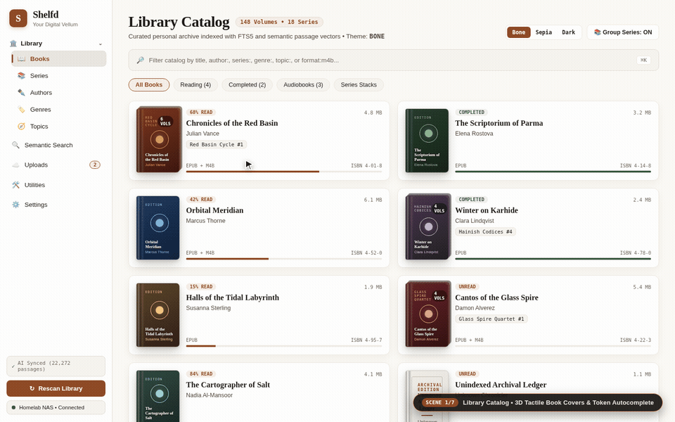

# Shelfd UI/UX Redesign ("The Tactile Scriptorium") — Interactive Walkthrough Demo

This directory contains the 7-scene interactive walkthrough recording of the redesigned **Shelfd ("The Tactile Scriptorium")** UI captured at `1440 × 900` (`30 fps`, `42.0 seconds`).

## Recording Artifacts

| File | Format / Codec | Resolution & Frame Rate | Purpose |
|---|---|---|---|
| [`tactile_scriptorium_demo.mp4`](tactile_scriptorium_demo.mp4) | MP4 (`H.264 / libx264`, `yuv420p`, `faststart`) | `1440 × 900` @ `30 fps` (`42.0s`) | High-definition full walkthrough video |
| [`tactile_scriptorium_demo.webm`](tactile_scriptorium_demo.webm) | WebM (`VP9 / libvpx-vp9`, `yuv420p`) | `1440 × 900` @ `30 fps` (`42.0s`) | Web-native VP9 video stream |
| [`tactile_scriptorium_demo.gif`](tactile_scriptorium_demo.gif) | Animated GIF (`lanczos` + 256-color `palettegen`/`paletteuse`) | `960 × 600` @ `10 fps` (`42.0s`) | Inline Markdown & PR preview |

---

## 7-Scene Walkthrough Storyboard

| Scene | Time Window | Route | Demonstrated UI/UX Improvements |
|---|---|---|---|
| **Scene 1: Library Catalog & Tactile Book Covers** | `00:00 – 00:07` | `/books` | Warm Parchment (`#FBF9F4`) surface hierarchy, 3D `TactileBookCover` left-edge spine creases, multi-volume series stack backing plates, and recessed filter bar with `author:` autocomplete dropdown and tabular `JetBrains Mono` counts. |
| **Scene 2: Dynamic Theme Engine (`Bone` → `Sepia` → `Dark`)** | `00:07 – 00:14` | `/settings` → `/books` | Live switching across **Bone**, **Sepia** (`#F4ECD8` Archival Vellum), and **Dark** (`#161412` Warm Dark Walnut) in Settings, proving 100% `ShelfdColors` propagation across `ShelfdSideNav`, `BentoCard`, `LibraryFilterBar`, and `ShelfdGridCard`. |
| **Scene 3: Book Detail Showcase, Bookmarks & RAG Chat** | `00:14 – 00:22` | `/books/:id` | 3D spine-lit Hero cover, Burnt Sienna `Read Book` & Warm Amber `Listen` CTAs, `JetBrains Mono` technical specifications (`EPUB` + `M4B`), clickable Bookmark cards, and Archival RAG Chat with verified passage citations. |
| **Scene 4: EPUB Reader, TOC Drawer & Typography Sheet** | `00:22 – 00:29` | `/books/:id/read` | Clicking a saved Bookmark jumps directly to the chapter in `ReaderView`; demonstrates fixed dark-mode contrast in the TOC `endDrawer` and `_TypographySheet`, plus switching to Sepia mode with the theme-adaptive `KindleSelectionToolbar`. |
| **Scene 5: Audiobook Studio & Persistent Mini-Player** | `00:29 – 00:35` | `/books/:id/listen` → `/books` | Nocturnal Obsidian (`#141315`) & Warm Amber (`#E5A967`) studio player, 14px physical audiobook sleeve crease, jitter-free tabular `JetBrains Mono` timestamps in `ScrubberBar`, and minimizing to the docked `MiniPlayerBar`. |
| **Scene 6: Semantic Search & Desktop Uploads Auto-Fill** | `00:35 – 00:40` | `/search` → `/uploads` | Burnt Sienna archival citation cards with `TactileBookCover` thumbnails and `Newsreader` passage blockquotes, followed by desktop `_MetadataInspector` with the new `Auto-Fill Metadata` modal, `Publisher`, and `Language` fields. |
| **Scene 7: Live Go Backend OAuth 2.0 Consent** | `00:40 – 00:42` | `/oauth/authorize` | Live Go server `/oauth/authorize` consent screen rendered in both Light (`#FBF9F4` / `#8E4A26`) and Dark (`#161412` / `#D98A5F`) schemes. |
