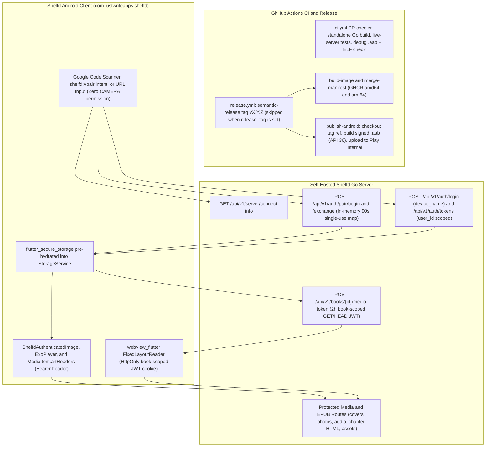

# Shelfd Android Release Pipeline & Self-Hosted Sign-In

*   **Author:** Ben Force
*   **Status:** Proposed
*   **Date:** 2026-11-24

---

## Overview

Shelfd currently builds and distributes only a single-container web deployment (`ghcr.io/thebenforce/shelfd`), where the Go server serves the compiled Flutter Web application from the same origin. This design updates the build and release pipeline to compile, test, sign, and publish the Flutter client as an Android App Bundle (`.aab`) under `com.justwriteapps.shelfd` to the Google Play `internal` testing track.

To make the Android client usable against self-hosted servers, this design decouples standalone Go server builds in CI and adds live-server Flutter integration tests alongside a tag-pinned Google Play publishing job in `release.yml`. It introduces 90-second single-use QR pairing from the web dashboard scanned via permissionless Google Play Services Code Scanner (plus manual HTTPS, private-CA HTTPS, Tailscale, and LAN HTTP sign-in), issues revocable per-device `shelfd_...` API tokens stored in Android Keystore, authenticates native image and audio loads via `Authorization` headers and book-scoped `WebView` media cookies, renders fixed-layout EPUBs via `webview_flutter`, and launches the self-hosted web dashboard for one-time plugin OAuth linking.

---

## The Problem

People who host Shelfd on a home server, NAS, or VPS cannot install a native Android app from Google Play or stay connected to their library on a phone. Shipping the existing Flutter codebase to Android fails at both the pipeline layer and the runtime sign-in layer:

1.  **No Android CI verification or Google Play release pipeline.** Both `.github/workflows/ci.yml` and `.github/workflows/release.yml` only build `flutter build web`. Android Gradle configuration still uses the placeholder `com.shelfd.shelf` package ID, pins outdated Gradle (`9.1.0`), AGP (`9.0.1`), and Kotlin (`2.3.20`) versions rejected by Flutter `stable`, signs release builds with local debug keys, omits the Kotlin Android plugin when `builtInKotlin=false`, and leaves `pubspec.yaml` hardcoded at `version: 1.0.0+1` (`versionCode = 1`), which Google Play rejects after the first upload. Meanwhile, `@shelfd/server` declares a workspace dependency on `@shelfd/app`, forcing a full web build even when CI only needs a standalone Go server binary for client integration tests.
2.  **Web-only cookie assumptions break native sign-in, covers, and EPUBs.** On the web, `POST /api/v1/auth/login` sets an `HttpOnly` `shelfd_token` cookie on the same origin, which browsers attach automatically to ``, `<audio>`, and `<iframe>` requests. On Android, `ConnectView` defaults to `http://localhost:8080` (the phone itself), the "Scan Server QR Code" card opens a placeholder dialog while the web dashboard generates no QR code at all, 8 Shelfd-origin `Image.network` call sites (out of 11 total) omit auth headers and return `401 Unauthorized`, fixed-layout EPUBs render a web-only placeholder box, and `openExternalUrl` returns `false` on Android when linking plugins via a hardcoded `http://localhost:8080` redirect fallback.
3.  **Plaintext token storage and destructive offline session resets.** Login currently stores a 7-day JWT in plaintext `SharedPreferences` (backed up to Google Drive by default), `ApiService.getMe()` fails to unwrap the server's `{"user": ...}` envelope against live Go servers, and `AuthRepository.checkInitialAuth()` deletes both the saved server URL and auth token whenever any network timeout occurs—wiping the user's session if they open the app in airplane mode or before Tailscale connects. Conversely, the server's `DELETE /api/v1/auth/tokens/{id}` endpoint deletes API tokens without verifying `user_id` ownership, and `SettingsView` provides no way to inspect or revoke paired devices.

---

## Goals

*   **Automated Google Play `internal` releases:** Build, R8-minify, sign (`com.justwriteapps.shelfd`, `compileSdk = flutter.compileSdkVersion` / `targetSdk = flutter.targetSdkVersion` at API 36, 16 KB ELF `LOAD` alignment), and upload `.aab` bundles to the Google Play `internal` track from `.github/workflows/release.yml` using a monotonic integer `versionCode` and an idempotent tag-pinned retry input, while keeping `.debug` side-by-side installs working locally.
*   **Fast CI Android build and live-server verification:** Compile the standalone `shelfd` Go binary in CI without triggering `flutter build web`, execute Flutter integration/widget tests against a live ephemeral `shelfd` process, and run an Android `.aab` compile, merged-manifest permission, and 16 KB ELF alignment gate on pull requests in `.github/workflows/ci.yml`.
*   **Self-hosted connectivity across homelab networks:** Connect and sign in to self-hosted Shelfd servers over public HTTPS domains, private homelab CA HTTPS (`<certificates src="user"/>`), Tailscale MagicDNS/CGNAT addresses, and private LAN HTTP IPs, with URL normalization, an 8-second connection probe timeout, and actionable TLS/DNS/cleartext error diagnostics.
*   **Permissionless 1-scan QR pairing:** Generate a single-use pairing QR code in Web `SettingsView` (rotating every 45 seconds with a 90-second server TTL, and warning when the browser origin is `localhost`/`127.0.0.1`) and scan it on Android via Google Play Services Code Scanner, OS camera `shelfd://pair` deep link, or clipboard paste—adding **zero** `android.permission.CAMERA` manifest permissions.
*   **Persistent, revocable per-device sessions:** Issue a named `shelfd_...` device token on mobile password login or QR pairing stored in `flutter_secure_storage` (pre-hydrated into memory at startup and excluded from Android Auto Backup), retain credentials across transient offline/network errors, enforce `user_id` ownership on `DELETE /api/v1/auth/tokens/{id}`, revoke the device token on logout, and expose an Active Devices & API Tokens revocation list in `SettingsView`.
*   **Authenticated media, fixed-layout EPUB rendering, and web-delegated plugin OAuth on Android:** Authenticate all Shelfd cover images, author photos, audio streams (`just_audio`), and lockscreen `MediaSession` artwork via origin-checked `Authorization: Bearer` headers (stripping `?token=shelfd_...` from native URL builders), authenticate `webview_flutter` fixed-layout EPUB pages and sub-resources via an `HttpOnly` `shelfd_token` cookie carrying a short-lived book-scoped media JWT, and launch external browsers via `url_launcher` so plugin OAuth links through the self-hosted web UI.

---

## Non-Goals

*   Promoting builds to Google Play `closed` or `production` tracks, or attaching standalone sideload `.apk` assets to GitHub Releases in this iteration.
*   Backward compatibility with older pre-Android Shelfd server versions (client and server ship together at the current API version).
*   Building a pure Dart HTML/CSS layout engine to replace `WebView` for fixed-layout (`pre-paginated`) EPUBs.
*   Introducing rotating refresh-token endpoints (`POST /api/v1/auth/refresh`).
*   Registering custom-scheme OAuth redirect URIs (`shelfd://oauth-callback`) for third-party server-side plugins such as Yoto.
*   Booting KVM Android emulators inside GitHub Actions pull-request CI.
*   Full offline catalog, audiobook, or EPUB file download management beyond existing chapter and highlight caching.

---

## Open Questions

None.

---

## Critical User Journeys (CUJs)

### CUJ 1: One-Scan QR Pairing from the Self-Hosted Web Dashboard

*   **Given:** A user has installed `com.justwriteapps.shelfd` from the Google Play `internal` track and is logged into their self-hosted Shelfd web dashboard on a laptop (`https://shelfd.tailnet.ts.net` or `http://192.168.1.50:8080`).
*   **When:** The user clicks **Pair Mobile Device** in Web `SettingsView` (or confirms their LAN/Tailscale URL if they opened the dashboard via `localhost`) to display a QR code (refreshed every 45 seconds with a 90-second server TTL), then taps **Scan Server QR Code** on Android `ConnectView` and points Google Code Scanner (or their stock OS camera) at the screen.
*   **Then:** Without prompting for `android.permission.CAMERA` or typing a password, the Android app exchanges the single-use pairing code at `POST /api/v1/auth/pair/exchange` for a named `shelfd_...` API token (`Shelfd Android (<Device Model>)`), stores the token and `token_id` in Android Keystore, loads `/books` with authenticated cover art, and lists the paired phone under Active Devices & API Tokens in `SettingsView`.

### CUJ 2: Manual URL Sign-In Across HTTPS, Private CA, Tailscale, or LAN HTTP

*   **Given:** A user opens Android `ConnectView` (which shows an empty URL field with placeholder hints rather than `http://localhost:8080`) and wants to sign in manually to a self-hosted Shelfd server—including a homelab proxy using a user-installed root CA.
*   **When:** The user enters `shelfd.example.com`, `shelfd.tailnet.ts.net`, or `192.168.1.50:8080` along with their username and password, and taps **Connect & Sync Library**.
*   **Then:** The app normalizes the URL, probes `/api/v1/server/connect-info` within 8 seconds (surfacing a specific TLS, DNS/Tailscale, or wrong-scheme message if unreachable), authenticates via `POST /api/v1/auth/login` with `device_name` to receive a revocable `shelfd_...` device token and user profile in one request, stores credentials in `flutter_secure_storage`, and navigates to `/books`.

### CUJ 3: Offline Launch, Roaming Recovery, and Clean Device Revocation

*   **Given:** A user previously signed in on Android and opens the app in airplane mode or while disconnected from their home Wi-Fi / Tailscale VPN.
*   **When:** Initial startup and library requests time out with a network error, and later the user either reconnects to Tailscale or revokes the device token from Web `SettingsView` (or taps **Disconnect / Sign Out** on the phone).
*   **Then:** During the network outage, `AuthRepository` preserves both `shelfd_server_url` and the stored `shelfd_...` token, rendering a retryable offline state on `/books` on cold launch (while keeping already-open or `ReaderRepository`-cached chapters intact across transient disconnects) and resuming live sync once connectivity returns. When the token is explicitly revoked (`401 Unauthorized`) or the user signs out, `ApiService`'s centralized unauthorized handler stops active audio and SSE streams, clears `WebView` cookies and the stored token while keeping `serverUrl` pre-filled, best-effort deletes `token_id` on the server, and redirects via `GoRouter` to `/connect`.

### CUJ 4: Fixed-Layout Read-Along EPUB Playback and Plugin Linking on Android

*   **Given:** A signed-in Android user opens a fixed-layout (`pre-paginated`) illustrated EPUB with SMIL read-along audio, and later configures an OAuth-backed plugin (such as Yoto) in `SettingsView`.
*   **When:** The user starts read-along playback in `FixedLayoutReader`, taps a sentence to seek or taps the page to toggle controls, and later taps **Open Web Dashboard to Link Account** inside `PluginConfigDialog`.
*   **Then:** `webview_flutter` renders the spread with all authenticated EPUB images, SVG overlays, and `@font-face` fonts loaded via an `HttpOnly` `shelfd_token` cookie containing a short-lived book-scoped media JWT (`cast:media:<bookID>`). `FixedLayoutReader` dispatches highlight JS calls only on SMIL segment transitions and bridges taps back to Flutter via `JavaScriptChannel`. Launching `${baseUrl}/settings?plugin=<name>` opens an external browser (preserving `?redirect=` across `/connect` if mobile Chrome has no web session yet and auto-opening `PluginConfigDialog` in `SettingsView`) without hitting the unreachable `http://localhost:8080` fallback.

### CUJ 5: Automated CI Verification and Google Play `internal` Track Publishing

*   **Given:** The one-time manual `versionCode: 1` `.aab` bootstrap has been completed in Google Play Console and signing/Play service-account secrets are configured in GitHub.
*   **When:** A pull request runs `.github/workflows/ci.yml`, and a maintainer subsequently triggers `.github/workflows/release.yml` (either cutting a new `semantic-release` version from `main` or retrying/rolling back Play upload for an existing `release_tag`).
*   **Then:** PR CI builds the standalone `shelfd` Go server without compiling Flutter Web, passes live-server Flutter integration/widget tests, and verifies the debug `.aab` merged manifest and 16 KB ELF alignment. On release, `release.yml` skips `semantic-release` when `release_tag` is set, checks out the exact `refs/tags/v<semver>` commit in `publish-android`, builds a release-signed `com.justwriteapps.shelfd` `.aab` with `--build-name=<semver>` and monotonic `--build-number`, and uploads it to the Google Play `internal` track (skipping upload when `dry_run: true`).

---

## Technical Plan (Architecture)

### 1. System Architecture & Data Flows

### 2. Android Identity, Gradle Toolchain, & Network Security Config

*   **Atomic Package Identity (`com.justwriteapps.shelfd`):**
    *   Update `namespace` and `applicationId` in `apps/app/android/app/build.gradle.kts` to `com.justwriteapps.shelfd`. Configure `debug` buildType with `applicationIdSuffix = ".debug"` and a distinct `"Shelfd (Dev)"` app label so local debug builds coexist alongside the Google Play `internal` install. Keep `name: shelf` unchanged in `apps/app/pubspec.yaml` to preserve internal Dart `package:shelf/...` imports.
    *   Move `MainActivity.kt` (`AudioServiceActivity` subclass) into `com.justwriteapps.shelfd`, set the launcher label to `"Shelfd"`, and update the `JustAudioBackground` notification channel ID in `main.dart` to `com.justwriteapps.shelfd.channel.audio` with error logging on initialization failure.
*   **Gradle, Kotlin, API 36, & Backup Hardening:**
    *   Upgrade Gradle Wrapper, Android Gradle Plugin, and Kotlin Gradle Plugin versions to satisfy Flutter `stable` (`3.50.0`) minimum toolchain checks, apply `id("org.jetbrains.kotlin.android")`, retain `compileSdk = flutter.compileSdkVersion` (`36`) and `targetSdk = flutter.targetSdkVersion` (`36`) with `minSdk = 24`, and cap Gradle JVM heap at 4 GB for 16 GB CI runners.
    *   Configure release signing from `key.properties` or `ANDROID_KEYSTORE_*` environment variables, falling back to debug signing locally when unset and failing fast in CI release builds if missing.
    *   Configure Android `backup_rules.xml` and `data_extraction_rules.xml` to exclude `FlutterSecureStorage.xml` from Android Auto Backup and device-to-device transfer.
*   **Network Security Configuration:**
    *   Configure `network_security_config.xml` with `cleartextTrafficPermitted="true"` and `<trust-anchors>` trusting both `system` and `user` CA certificates. This supports public HTTPS, Tailscale `.ts.net` HTTPS, homelab reverse proxies signed by a user-installed root CA, and home LAN/Tailscale HTTP.
    *   At the Dart boundary (`UrlNormalizer`), bare domain names without an explicit scheme default to `https://` (falling back to `http://` only on private RFC1918, CGNAT `100.64.0.0/10`, `.local`/`.lan`, or explicit `:8080` inputs), non-private cleartext `http://` URLs require explicit user confirmation before sending credentials, and cross-origin HTTP downgrades strip `Authorization` headers.

### 3. CI/CD & Google Play `internal` Release Pipeline

*   **Decoupling Standalone Server Builds:**
    *   Remove `"@shelfd/app": "workspace:*"` from `apps/server/package.json` (and update `pnpm-lock.yaml`). Go compilation does not embed web assets; `Dockerfile` and `release.yml` already assemble the web bundle explicitly.
    *   Register `@shelfd/app#build:aab` and `@shelfd/app#test:live` tasks in `turbo.json` and `apps/app/package.json`.
*   **Pull Request Verification (`.github/workflows/ci.yml`):**
    *   Set up JDK 17 with Gradle caching, compile standalone `apps/server/dist/shelfd`, run the live-server Flutter integration/widget suite (`apps/app/test_live/`) against an isolated localhost `shelfd` process, and dump server logs on failure.
    *   Run `flutter build appbundle --debug`, assert that `android.permission.CAMERA` is absent from Gradle's merged `AndroidManifest.xml`, and verify via `readelf` that all bundled `arm64-v8a`/`x86_64` native `.so` libraries have 16 KB (`0x4000`) ELF `LOAD` segment alignment.
*   **Google Play Release Job (`.github/workflows/release.yml`):**
    *   Add optional `workflow_dispatch` input `release_tag` (`vX.Y.Z`). Gate the `release` job on `inputs.release_tag == ''` so tag-targeted retries or rollbacks never run `semantic-release` on `main` or overwrite GHCR `:latest`.
    *   Run `publish-android` in parallel with `build-image` whenever `release` publishes a new version or `inputs.release_tag` is provided. Explicitly check out `refs/tags/v${VERSION}`, compute monotonic `BUILD_NUMBER = 100000 + github.run_number` (guarded by a minimum floor check), build the release-signed `.aab`, upload `.aab` + R8 `mapping.txt` artifacts, and when `!inputs.dry_run`, publish to Google Play `internal` (`status: completed`) via `r0adkll/upload-google-play@v1`.
    *   Document the mandatory one-time manual Play Console bootstrap (`versionCode: 1` upload, Play App Signing, `FOREGROUND_SERVICE_MEDIA_PLAYBACK` declaration, and GCP service account permissions) in `docs/android-release-setup.md`.

### 4. Self-Hosted Discovery, Permissionless QR Pairing, & Session Lifecycle

*   **Connection Probing & Diagnostics:**
    *   Leave the Server URL field empty on native platforms when no saved URL exists (removing the native `http://localhost:8080` default) and wrap inputs in an `AutofillGroup`.
    *   Normalize URLs and probe `GET /api/v1/server/connect-info` with an 8-second timeout using an isolated `ApiService` instance so failed probes never mutate active session state. Unify comma-separated `X-Forwarded-Host` / `X-Forwarded-Proto` origin detection across `connect.go`, `oauth.go`, and `auth.go`.
    *   Map transport, TLS, and HTTP status failures (`ConnectDiagnostics`) to plain-English messages (distinguishing unreachable LAN Wi-Fi, inactive Tailscale VPN, untrusted CA certificate, HTTP/HTTPS scheme mismatch, and invalid credentials), paired with a token-redacted **Copy Connection Diagnostics** action.
*   **Single-Use QR Pairing (In-Memory 90s TTL Map + Permissionless Google Code Scanner):**
    *   **Server (`AuthHandler`):** Maintain a mutex-guarded in-memory map of SHA-256 hashed single-use pairing codes with a 90-second TTL, bounded capacity, and `RemoteAddr`-based + global failed-attempt rate limiting on exchange. Authenticated `POST /api/v1/auth/pair/begin` issues a single-use code, and public `POST /api/v1/auth/pair/exchange` atomically consumes it and mints a named `shelfd_...` `APIToken` via a shared `issueAPIToken` helper.
    *   **Web Producer (`SettingsView`):** Add a **Pair Mobile Device** modal on Web (`qr_flutter`). When opened on `localhost`, `127.0.0.1`, or `0.0.0.0`, require the user to confirm their reachable LAN IP, Tailscale hostname, or HTTPS domain before generating the QR code. Encode `shelfd://pair?u=<urlEncodedBaseUrl>&c=<codeNonce>` and auto-refresh the displayed QR code every 45 seconds (leaving a 45-second validity cushion on the 90-second server nonce) alongside a **Copy Pairing Link** button.
    *   **Android Scanner (`ConnectView` + `MainActivity.kt`):** Invoke `com.google.android.gms:play-services-code-scanner` (`barcode_ui` Play Services dependency metadata) and forward `shelfd://pair` intents (`onCreate`/`onNewIntent` on `singleTop` `MainActivity`) plus `android.os.Build.MODEL` over a single Kotlin `MethodChannel` (`com.justwriteapps.shelfd/qr_scanner`). This requires zero `android.permission.CAMERA` permission and zero extra deep-link or device-info Flutter plugins, while supporting stock OS camera scans on non-GMS devices and a **Paste Pairing Link** fallback.
*   **Per-Device Token Lifecycle, Pre-Hydrated Secure Storage, & Centralized `401` Handling:**
    *   **Atomic Manual Login:** Extend `POST /api/v1/auth/login` with an optional `device_name` parameter so native clients receive a named `shelfd_...` `APIToken` (`api_token`, `api_token_id`) and `user` profile in a single round-trip after preflight, and fix `ApiService.getMe()` to unwrap `{"user": ...}`.
    *   **Pre-Hydrated `StorageService` & Offline Resilience:** Pre-hydrate `(token, tokenId)` from `flutter_secure_storage` into a synchronous in-memory `StorageService` cache in `main()` before `runApp()` (migrating legacy `SharedPreferences` tokens and recovering cleanly from Android Keystore `PlatformException` errors), and schedule `checkAuth()` post-mount. Only an explicit `401` clears stored tokens (retaining `shelfd_server_url`).
    *   **Centralized `401` Hook & Scoped Revocation:** Handle session `401` responses in one `ApiService.onUnauthorized` callback notifying `AuthNotifier`, and make `apiServiceProvider` watch `authProvider` so dependent Riverpod providers rebuild automatically and `GoRouter.refreshListenable` redirects to `/connect`. Enforce `user_id` ownership on `DELETE /api/v1/auth/tokens/{id}`, best-effort revoke `token_id` on Sign Out / Switch Server (`!kIsWeb`), and add an **Active Devices & API Tokens** revocation list in `SettingsView`.

### 5. Authenticated Native Media, Fixed-Layout EPUB `WebView`, & Plugin Web-UI Handoff

*   **Origin-Scoped Header Auth for Native Widgets, ExoPlayer, & Lockscreen Artwork:**
    *   Forward `baseUrl` into nested `Author.fromJson` and `Series.fromJson` inside `Book.fromJson`. Strip `?token=` query-string injection of permanent `shelfd_...` tokens from native `ApiService` URL builders, and prevent `AuthHandler.Me` from echoing `shelfd_` bearer tokens into `Set-Cookie`.
    *   Create `ShelfdAuthenticatedImage` attaching `Authorization: Bearer $token` headers **only** when the target URI's scheme, host, and port match `apiService.baseUrl`, replacing the 8 Shelfd-origin `Image.network` call sites while leaving external Gutenberg/OpenLibrary/Yoto URLs header-free.
    *   Pass origin-checked `Authorization: Bearer` headers across all `JustAudioPlayerEngine.setUrl` paths and `MediaItem.artHeaders` (`audio_service`), and fix the embedded-EPUB media-overlay branch of `AudiobookHandler.StreamAudio` (`audiobooks.go:138`) to pass file `ModTime()` instead of `time.Now()` for ExoPlayer `If-Range` byte-range resumes.
*   **Book-Scoped Media JWT & Fixed-Layout EPUB `WebView` (`html_view_io.dart`):**
    *   Reuse existing `GenerateCastMediaJWT` and `CastScopeAllowsRequest` (`cast:media:<bookID>`, extended to allow `GET`/`HEAD` on `/api/v1/books/<bookID>/chapters/{index}/html` and permitting `HEAD` on `GetChapterHTML`, `GetAuthorPhoto`, and `GetUploadJobCover`), exposed at authenticated `POST /api/v1/books/{id}/media-token` (`2h` TTL). Set `Cache-Control: private, max-age=86400` on `GetBookAsset`.
    *   Before loading fixed-layout pages in `FixedLayoutReader` on Android, seed an `HttpOnly` (and scheme-matched `Secure`) `shelfd_token=<book_media_jwt>` cookie via Android's native `CookieManager` (`webview_flutter_android`), which existing `AuthMiddleware` (`r.Cookie("shelfd_token")`, already supporting header, cookie, and `?token=` extraction) accepts for the chapter HTML plus all ``, SVG `<image>`, `<link>` CSS, and `@font-face` sub-resources. Clear `WebView` cookies on logout or server switch.
    *   Share a common `buildHtmlFrame` signature across `html_view_io.dart`, `html_view_web.dart`, and `html_view_stub.dart` (falling back to the stub when `FLUTTER_TEST` is set, `WebViewPlatform.instance == null`, or on desktop). Cap live `WebViewController`s to `<= 2`, deduplicate `highlightHtmlFrame` calls to SMIL segment transitions, and bridge tap-to-seek and chrome-toggle taps via `JavaScriptChannel('ShelfdBridge')`.
*   **Plugin OAuth via Self-Hosted Web Dashboard:**
    *   Implement external browser launching (`url_launcher` + Android 11+ `<queries>`) under `lib/platform/`. On non-web platforms, `PluginConfigDialog` opens `${apiService.baseUrl}/settings?plugin=<encodedName>` in the browser while retaining its existing manual authorization-code input field.
    *   Preserve same-origin `?redirect=` targets across `/connect` login in `router.dart` / `ConnectView`, and update `SettingsView` to auto-open `PluginConfigDialog` when `?plugin=<name>` is present without `?code=`.

---

## Alternatives Considered

### Alternative A: GitHub Releases APK Distribution First

*   **Pros:** Zero Google Play Console setup, no service account credentials, and immediate sideloading or Obtainium updates directly from GitHub tags.
*   **Cons:** Requires users to enable Android unknown-sources sideloading, lacks automatic background updates, and defers validation of Play App Signing, API 36 target requirements, foreground-service declarations, and 16 KB ELF alignment.
*   **Reason for Rejection:** Publishing `.aab` bundles to the Google Play `internal` track under the existing `com.justwriteapps` account delivers automatic updates to testers and enforces Play App Signing, API 36, and 16 KB alignment gates from the first build.

### Alternative B: Short-Lived JWTs + Rotating Refresh Tokens (`POST /api/v1/auth/refresh`)

*   **Pros:** Bounds bearer token lifetime if a raw access token is exfiltrated without needing manual revocation.
*   **Cons:** Requires stateful refresh-token rotation tracking in SQLite and creates concurrent refresh race conditions when SSE streams, cover fetches, and API calls encounter an expired access token simultaneously after offline periods.
*   **Reason for Rejection:** Issuing a named, revocable `shelfd_...` per-device API token reuses the server's existing `api_tokens` table, eliminates concurrent refresh races, and enables immediate per-device revocation in `SettingsView`.

### Alternative C: Pure HTML-to-Flutter Widget Rendering for Fixed-Layout EPUBs

*   **Pros:** Avoids embedding platform `WebView` instances and keeps all layout inside Flutter's render tree.
*   **Cons:** Dart HTML-to-widget libraries (`flutter_widget_from_html`, `flutter_html`) do not implement pixel-exact CSS `position: absolute`, `@font-face` fonts extracted from EPUB archives, SVG `viewBox` text positioning, or DOM-id SMIL read-along overlays—breaking layouts on illustrated books and comics.
*   **Reason for Rejection:** `webview_flutter` inside Flutter's `FixedLayoutReader` reuses `RewritePageHTML` (extended with a `ShelfdBridge` channel) to render EPUB CSS, embedded fonts, SVG, and SMIL highlights in Android's system Chromium `WebView`.

### Alternative D: Booting KVM Android Emulators in GitHub Actions PR CI

*   **Pros:** Exercises full Android APK installation, Gradle packaging, and native platform channels in a single end-to-end run.
*   **Cons:** Adds 8–15 minutes per PR on GitHub Actions runners and introduces KVM/AVD boot flakiness.
*   **Reason for Rejection:** Running Flutter integration/widget tests directly against a live standalone `shelfd` Go server process on the CI host, paired with a separate `flutter build appbundle --debug` + merged-manifest + `readelf` gate, verifies API contracts and Android packaging without KVM overhead.

### Alternative E: Raw `android.permission.CAMERA` (`mobile_scanner`) for QR Pairing

*   **Pros:** Renders a customizable in-app Flutter camera viewfinder without relying on Google Play Services.
*   **Cons:** Injects `<uses-permission android:name="android.permission.CAMERA"/>` into the merged manifest (requiring Play Console camera privacy policy disclosures and runtime permission prompts), adds 5–15 MB of native CameraX/MLKit libraries, and hides the app from camera-less Android e-ink readers and Chromebooks unless `<uses-feature>` overrides are maintained.
*   **Reason for Rejection:** Google Play Services Code Scanner (`play-services-code-scanner`) paired with a `shelfd://pair` OS-camera deep link and clipboard paste fallback achieves 1-tap scanning with zero `CAMERA` permission.

### Alternative F: Custom-Scheme Mobile OAuth Redirects (`shelfd://oauth-callback`) for Server Plugins

*   **Pros:** Completes third-party plugin PKCE flows inside a mobile Custom Tab returning directly to the Android app.
*   **Cons:** Third-party OAuth providers (such as Yoto/Auth0) reject `shelfd://oauth-callback` unless every self-hoster manually registers the custom scheme in their upstream OAuth app allowlist; custom schemes are also vulnerable to local app interception on Android and collide with `GoRouter` routing.
*   **Reason for Rejection:** Plugin OAuth credentials live on the self-hosted Shelfd server rather than on the phone, so opening `${baseUrl}/settings?plugin=<name>` in the browser via `url_launcher` reuses the existing allowlisted web callback URL.

### Alternative G: SQLite Persistence (`oauth_codes` Reuse or New Migration) for Pairing Nonces

*   **Pros:** Preserves an active 90-second QR code across a server process restart.
*   **Cons:** Inserts non-OAuth sentinel rows into `oauth_codes` or requires a new SQLite/PostgreSQL schema migration and dual `StorageEngine` (`sqlite.go` + `bun.go`) boilerplate for ephemeral codes that expire in 90 seconds on a single-node homelab daemon.
*   **Reason for Rejection:** An in-memory mutex-guarded TTL map on `AuthHandler` avoids schema migrations and sentinel coupling while satisfying single-instance self-hosted pairing.

### Alternative H: Seeding `WebView` & `MediaItem.artUri` Directly with Permanent `shelfd_...` Tokens or a Local Loopback Proxy

*   **Pros:** Direct `shelfd_...` seeding requires zero new server endpoints; a `127.0.0.1` Dart loopback proxy keeps tokens out of cookies and query strings.
*   **Cons:** Direct `shelfd_...` seeding exposes an unexpiring full-privilege account credential inside WebView cookies and `?token=` URLs; a Dart loopback proxy requires custom `206 Partial Content` range forwarding and breaks if Android suspends the Dart socket during background audio playback.
*   **Reason for Rejection:** Extending existing book-scoped `GenerateCastMediaJWT` / `CastScopeAllowsRequest` (`POST /api/v1/books/{id}/media-token`) for `HttpOnly` `WebView` cookies and passing `MediaItem.artHeaders` for lockscreen art eliminates permanent `shelfd_...` tokens from all URLs, logs, and cookies without background proxy sockets.

---

## Non-Functional Requirements

*   **Security & Privacy:**
    *   **Zero `CAMERA` Permission:** The merged release `AndroidManifest.xml` must not contain `android.permission.CAMERA` (enforced by CI merged-manifest inspection), avoiding camera runtime prompts, Play Console camera policy declarations, and Chromebook/e-ink device filtering.
    *   **Credential Containment:** Permanent `shelfd_...` tokens must be stored exclusively in Android Keystore-backed `flutter_secure_storage`, excluded from Android cloud backups, never sent to non-matching origins, and never placed in `?token=` query strings or `WebView` cookies (which must receive only 2-hour `GET`/`HEAD` book-scoped `cast:media:<bookID>` JWTs). `RequestLoggerMiddleware` must log `auth_source` and `auth_error_reason` on `401`/`403` without logging query strings or raw tokens, and client error strings must redact `token=` parameters.
    *   **Tenant Isolation:** `DELETE /api/v1/auth/tokens/{id}` must enforce `user_id` ownership in both SQLite and Bun repositories.
*   **Performance & Resource Footprint:**
    *   `FixedLayoutReader` must mount at most 2 native `WebView` instances simultaneously and dispatch JS highlight updates only on SMIL segment state transitions (not on 10 Hz audio position ticks).
    *   Connection preflight probes must enforce an 8-second timeout (`DELETE` logout revocation must enforce a 3-second timeout) to bound unreachable LAN/Tailscale checks rather than waiting for 60–120s OS TCP timeouts.
    *   CI Gradle JVM heap must be capped at `-Xmx4G` so `.aab` R8 release builds stay within 16 GB GitHub Actions runner memory.
*   **Rollout & Rollback:**
    *   Google Play `internal` publishing must run in an isolated job parallel to `build-image` so Play API errors cannot block Docker container releases, must skip `semantic-release` when `inputs.release_tag` is set, must check out the exact `refs/tags/v${VERSION}` commit, and must assign monotonic `100000 + github.run_number` version codes.
    *   Rollback on the Google Play `internal` track must be executable by dispatching `release.yml` with `release_tag` set to the prior working git tag, compiling that tag's exact source with a higher `versionCode`.

---

## Risks & Mitigations

*   **In-Memory Pairing Nonce Eviction on Restart or Multi-Replica Deployments:**
    *   *Risk:* Because 90-second pairing nonces live in `AuthHandler` memory (max 64 entries), restarting the Shelfd container invalidates an open QR code, and load-balanced multi-replica deployments without sticky sessions would fail `pair/exchange`.
    *   *Mitigation:* Shelfd is a single-container SQLite/homelab daemon; if a restart invalidates a QR code (`401`), closing/re-opening or waiting 45 seconds in Web `SettingsView` mints a fresh nonce automatically.
*   **Cleartext HTTP (`cleartextTrafficPermitted="true"`) & User CA (`<certificates src="user"/>`) Interception Surface:**
    *   *Risk:* Permitting cleartext HTTP for LAN homelabs risks transmitting passwords or bearer tokens in plaintext if a user enters an `http://` URL for a public host over untrusted Wi-Fi, and trusting user CAs allows TLS inspection on MDM-managed devices with installed root CAs.
    *   *Mitigation:* `UrlNormalizer` defaults scheme-less public domains to `https://`, strips `Authorization` headers on cross-origin HTTP redirects, and requires an explicit cleartext confirmation prompt in `ConnectView` before sending credentials over `http://` to any host outside RFC1918 private LAN, `100.64.0.0/10` Tailscale CGNAT, or `.local`/`.lan` mDNS ranges.
*   **Workflow-Path Sensitivity of `github.run_number` for Play `versionCode`:**
    *   *Risk:* GitHub Actions scopes `github.run_number` to `.github/workflows/release.yml`'s file path; renaming the workflow file would reset `run_number` to `1` and collide with previously uploaded `100000 + N` version codes on Google Play.
    *   *Mitigation:* Enforce a minimum `BUILD_NUMBER` floor check in `publish-android` (`BUILD_NUMBER > 100000`) and document in `release.yml` and `docs/android-release-setup.md` that renaming the workflow requires bumping the base offset constant.
*   **Google Play Console Manual Bootstrap & First-Run `barcode_ui` Download Delay:**
    *   *Risk:* Google Play's Publisher API rejects automated uploads until `versionCode: 1` is uploaded manually in Play Console UI, and freshly installed devices may briefly download Play Services' `barcode_ui` module on first QR scan.
    *   *Mitigation:* `docs/android-release-setup.md` provides a step-by-step pre-CI bootstrap checklist, `<meta-data android:name="com.google.mlkit.vision.DEPENDENCIES" android:value="barcode_ui"/>` requests install-time module delivery from Google Play, and `ConnectView` surfaces a 1-tap **Paste Pairing Link** fallback whenever `GmsBarcodeScanning` reports `UNAVAILABLE`.
*   **Orphaned Device `api_tokens` Across App Reinstalls:**
    *   *Risk:* Excluding `FlutterSecureStorage.xml` from Android cloud backup prevents stale token restoration on new phones, which means uninstalling/reinstalling the app without signing out leaves an orphaned `shelfd_...` row in `api_tokens` (and `change-password` intentionally does not wipe `api_tokens` to avoid breaking MCP agent tokens).
    *   *Mitigation:* Expose **Active Devices & API Tokens** in `SettingsView` showing each token's device name (`Shelfd Android (<Model>)`), creation timestamp, `"This device"` badge, and 1-tap **Revoke** button.

---

## Additional Resources

*   [TECHNICAL_DESIGN_DOCUMENT.md](../TECHNICAL_DESIGN_DOCUMENT.md) — Core Shelfd architecture and `api_tokens` schema reference.
*   [audiobook-support-plan.md](../audiobook-support-plan.md) — Background audio (`just_audio_background`) and SMIL read-along design context.

---

## Future Improvements

*   **Multi-Endpoint LAN/Tailscale Failover Profiles:** Store ordered LAN + Tailscale URLs per server `instance_id` so the client switches automatically when roaming off home Wi-Fi without manual URL edits.
*   **Google Play Closed/Production Track Promotion & GitHub Release APKs:** Add promotion workflows and split-ABI sideload APKs once internal testing stabilizes.
*   **Offline Catalog, EPUB, & Audiobook File Downloads:** Add local catalog/spine caching and full archive/audio file downloading for multi-day offline travel beyond chapter caching.

---

## Detailed Implementation Plan

The implementation is partitioned into 5 sequential, independently verifiable phases so every phase leaves the repository compiling and passing tests.

### Phase 1: Monorepo Decoupling & Android Gradle / Identity / Manifest Foundation

#### 1. `.gitignore` and `apps/app/android/.gitignore` (Modify)

*   **Type / Scope:** Repository Git Ignore Configuration
*   **Proposed Changes:**
    *   Add `*.jks`, `*.keystore`, `key.properties`, `*play-service-account*.json`, and `google-play-key.json` to root `.gitignore` (and add `*play-service-account*.json` / `google-play-key.json` alongside existing keystore rules in `apps/app/android/.gitignore`) to prevent accidental staging of local signing and Play credentials.

#### 2. `apps/server/package.json` and `pnpm-lock.yaml` (Modify)

*   **Type / Scope:** Monorepo Server Package Manifest & Lockfile
*   **Proposed Changes:**
    *   Remove `"@shelfd/app": "workspace:*"` from `dependencies` in `apps/server/package.json` so `pnpm --filter @shelfd/server build` compiles the standalone Go binary without triggering `flutter build web`.
    *   Update `pnpm-lock.yaml` via `pnpm install` so `pnpm install --frozen-lockfile` passes in CI and release workflows.

#### 3. `apps/app/package.json` and `turbo.json` (Modify)

*   **Type / Scope:** Monorepo Task Orchestration
*   **Proposed Changes:**
    *   Add `"build:aab": "flutter build appbundle"` in `apps/app/package.json` and register `"@shelfd/app#build:aab"` in `turbo.json` (`outputs: ["build/app/outputs/bundle/**"]`). *(Note: `test:live` is wired in Phase 5 alongside `apps/app/test_live/` so `pnpm` scripts never point to a missing directory.)*

#### 4. `apps/app/pubspec.yaml` and `apps/app/pubspec.lock` (Modify)

*   **Type / Scope:** Flutter Dependencies Manifest
*   **Proposed Changes:**
    *   Add pinned caret dependencies: `flutter_secure_storage: ^11.2.0` (Android Keystore storage compatible with `win32 ^6.3.0`), `webview_flutter: ^4.10.0` and `webview_flutter_android: ^4.3.2` (Android fixed-layout EPUB rendering and native `CookieManager`), `url_launcher: ^6.3.1` (external browser launching), and `qr_flutter: ^4.1.0` (rendering pairing QR codes in Web `SettingsView`). Keep `name: shelf` unchanged.

#### 5. `apps/app/android/gradle/wrapper/gradle-wrapper.properties`, `apps/app/android/settings.gradle.kts`, and `apps/app/android/gradle.properties` (Modify)

*   **Type / Scope:** Android Gradle Toolchain & JVM Configuration
*   **Proposed Changes:**
    *   `gradle-wrapper.properties`: Upgrade `distributionUrl` from `gradle-9.1.0-all.zip` to `gradle-9.5.0-all.zip` (satisfying Flutter `3.50.0` `DependencyVersionChecker` `>= 9.3.1`).
    *   `settings.gradle.kts`: Upgrade `id("com.android.application")` to `"9.3.1"` and `id("org.jetbrains.kotlin.android")` to `"2.4.20"` (satisfying Flutter `3.50.0` minimums `AGP >= 9.1.1` and `KGP >= 2.4.10`).
    *   `gradle.properties`: Reduce `org.gradle.jvmargs` from `-Xmx8G -XX:MaxMetaspaceSize=4G` to `-Xmx4G -XX:MaxMetaspaceSize=2G`.

#### 6. `apps/app/android/app/build.gradle.kts` (Modify)

*   **Type / Scope:** Android App Module Build Configuration
*   **Proposed Changes:**
    *   Apply `id("org.jetbrains.kotlin.android")` between `com.android.application` and `dev.flutter.flutter-gradle-plugin`, and enable `buildFeatures { resValues = true }`.
    *   Set `namespace = "com.justwriteapps.shelfd"`, `applicationId = "com.justwriteapps.shelfd"`, `compileSdk = flutter.compileSdkVersion` (`36`), `targetSdk = flutter.targetSdkVersion` (`36`), and `minSdk = 24`.
    *   Configure `debug` buildType with `applicationIdSuffix = ".debug"` and `resValue("string", "app_name", "Shelfd (Dev)")`, and `release` `defaultConfig` with `resValue("string", "app_name", "Shelfd")`.
    *   Load release signing config from `apps/app/android/key.properties` or env vars (`ANDROID_KEYSTORE_PATH`, `ANDROID_KEYSTORE_PASSWORD`, `ANDROID_KEY_ALIAS`, `ANDROID_KEY_PASSWORD`); fall back to `signingConfigs.getByName("debug")` locally when unset, and fail Gradle configuration when `System.getenv("CI") == "true"` on `Release` tasks without keystore credentials.
    *   Add `implementation("com.google.android.gms:play-services-code-scanner:16.1.0")`.

#### 7. `apps/app/android/app/src/main/kotlin/com/shelfd/shelf/MainActivity.kt` (Delete) and `apps/app/android/app/src/main/kotlin/com/justwriteapps/shelfd/MainActivity.kt` (Create)

*   **Type / Scope:** Android Native Entry Activity, Permissionless QR Scanner, & Deep-Link Channel
*   **Proposed Changes:**
    *   Move `MainActivity` (`AudioServiceActivity` subclass) into `package com.justwriteapps.shelfd`.
    *   Register `MethodChannel(flutterEngine.dartExecutor.binaryMessenger, "com.justwriteapps.shelfd/qr_scanner")` handling:
        *   `"scanQrCode"`: Invokes `GmsBarcodeScanning.getClient(this, GmsBarcodeScannerOptions.Builder().setBarcodeFormats(Barcode.FORMAT_QR_CODE).build()).startScan()`, returning the raw string on success, `null` on user cancel (`CommonStatusCodes.CANCELED`), or `result.error("UNAVAILABLE", e.message, null)` when GMS / `barcode_ui` is unavailable.
        *   `"getDeviceModel"`: Returns `"${android.os.Build.MANUFACTURER} ${android.os.Build.MODEL}".trim()`.
        *   `"getInitialPairUri"` & `onNewIntent` push `"onPairUri"`: Captures `shelfd://pair?...` intent data on cold start (`intent?.dataString`) and warm `singleTop` delivery (`onNewIntent`), clearing consumed intent data so single-use pairing URIs are never replayed.
        *   `"setWebViewCookie"` & `"clearWebViewCookies"`: Delegates to `android.webkit.CookieManager.getInstance()` so `HttpOnly; SameSite=Lax` flags are preserved on Android `WebView` requests.

#### 8. `apps/app/android/app/src/main/res/values/strings.xml`, `res/xml/network_security_config.xml`, `res/xml/backup_rules.xml`, `res/xml/data_extraction_rules.xml` (Create), and `apps/app/android/app/src/main/AndroidManifest.xml` (Modify)

*   **Type / Scope:** Android Resource Policies & Application Manifest
*   **Proposed Changes:**
    *   `strings.xml`: Define default `app_name` (`Shelfd`).
    *   `network_security_config.xml`: Configure `<base-config cleartextTrafficPermitted="true"><trust-anchors><certificates src="system"/><certificates src="user"/></trust-anchors></base-config>`.
    *   `backup_rules.xml` & `data_extraction_rules.xml`: Specify `<exclude domain="sharedpref" path="FlutterSecureStorage.xml"/>` and `<exclude domain="sharedpref" path="FlutterSecureKeyStorage.xml"/>` under `<full-backup-content>`, `<cloud-backup>`, and `<device-transfer>` so Keystore-encrypted auth tokens and wrapped AES keys are never cloud-backed up while non-sensitive reader preferences remain intact.
    *   `AndroidManifest.xml`: Reference `@string/app_name`, `@xml/network_security_config`, `@xml/backup_rules`, and `@xml/data_extraction_rules`; add `<meta-data android:name="com.google.mlkit.vision.DEPENDENCIES" android:value="barcode_ui"/>`; add `<meta-data android:name="flutter_deeplinking_enabled" android:value="false"/>` plus a `shelfd://pair` (`android:scheme="shelfd"`, `android:host="pair"`) `<intent-filter>` on `.MainActivity` (`singleTop`); add `<queries>` for `http` and `https` `ACTION_VIEW` and `android.support.customtabs.action.CustomTabsService`. Confirm zero `android.permission.CAMERA` entries exist.

*   **Phase 1 Checkpoint:** `pnpm install --frozen-lockfile && pnpm --filter @shelfd/server build && cd apps/app && flutter pub get && flutter build appbundle --debug`

---

### Phase 2: Go Server Token Isolation, QR Pairing, Book Media JWT, `HEAD` Handlers, & EPUB JS Bridge

#### 9. `apps/server/internal/repository/storage.go`, `apps/server/internal/repository/sqlite.go`, `apps/server/internal/repository/bun.go`, and `apps/server/internal/repository/sqlite_test.go` (Modify)

*   **Type / Scope:** Go Server Persistence Layer
*   **Proposed Changes:**
    *   Change `DeleteAPIToken(ctx context.Context, userID, tokenID string) error` across `StorageEngine`, `SQLiteStorageEngine`, and `BunStorageEngine` to execute `DELETE FROM api_tokens WHERE id = ? AND user_id = ?` (returning `repository.ErrNotFound` when 0 rows are affected).
    *   Update `sqlite_test.go` (including cross-user deletion negative tests).

#### 10. `apps/server/internal/api/jwt.go`, `apps/server/internal/api/middleware.go`, `apps/server/internal/api/auth.go`, `apps/server/internal/api/oauth.go`, `apps/server/internal/api/connect.go`, and `apps/server/internal/api/router.go` (Modify)

*   **Type / Scope:** Go Server Auth, Pairing, Book Media Token, & Proxy Origin Helpers
*   **Proposed Changes:**
    *   `connect.go`, `oauth.go`, & `auth.go`: Extract shared `resolveExternalOrigin(r *http.Request, cfgHost string, cfgPort int) string` and `isHTTPSRequest(r *http.Request) bool` helpers in package `api` that split comma-separated `X-Forwarded-Host` and `X-Forwarded-Proto` headers on `,` (taking the first trimmed entry), and reuse them across `ConnectHandler.GetConnectInfo`, `OAuthHandler`, and `AuthHandler` cookie `Secure` flags.
    *   `jwt.go` & `middleware.go`: Reuse `GenerateCastMediaJWT(userID, username, bookID, secret, 2*time.Hour)` (`cast:media:<bookID>`). Extend `CastScopeAllowsRequest` in `middleware.go` to also allow `GET`/`HEAD` on `/api/v1/books/<bookID>/chapters/<identifier>/html` (`strings.HasPrefix(reqPath, "/api/v1/books/"+bookID+"/chapters/") && strings.HasSuffix(reqPath, "/html")`). Inject a mutable `*authLogDiagnostics` struct pointer into `r.Context()` inside `RequestLoggerMiddleware` before `next.ServeHTTP` so `AuthMiddleware` populates `auth_source` (`bearer_api_token`, `bearer_jwt`, `cookie`, `query`, `none`) and `auth_error_reason` (`missing_token`, `invalid_token`, `insufficient_scope`) logged on `401`/`403` without logging query strings or raw tokens.
    *   `auth.go` & `oauth.go`:
        *   Extract shared `issueAPIToken(ctx context.Context, repo repository.StorageEngine, userID, name string) (*repository.APIToken, string, error)` reused by `AuthHandler.CreateToken`, `OAuthHandler.HandleToken`, `AuthHandler.Login` (when optional `device_name` is non-empty on `LoginRequest`, returning optional `"api_token"` and `"api_token_id"` fields in `LoginResponse`), and `AuthHandler.PairExchange`.
        *   In `AuthHandler.Me`, skip `http.SetCookie(w, "shelfd_token", ...)` when `strings.HasPrefix(token, "shelfd_")` so permanent API tokens are never echoed into cookies.
        *   Update `AuthHandler.DeleteToken` to pass `user.ID` into `h.repo.DeleteAPIToken(r.Context(), user.ID, tokenID)`.
        *   Add mutex-guarded pairing map (`max 64` entries, `90s` TTL) + `RemoteAddr` rate limiter (`10` attempts / `60s` per IP and `30` failed attempts / `60s` globally, returning `429 Too Many Requests`):
            *   `POST /api/v1/auth/pair/begin` (authenticated): Returns `201 Created` `{"code": "<64-hex>", "expires_at": "<RFC3339>"}`.
            *   `POST /api/v1/auth/pair/exchange` (public): Accepts `{"code": "...", "device_name": "..."}`, atomically deletes and verifies the non-expired SHA-256 hash, calls `issueAPIToken`, and returns `200 OK` `{"id": token.ID, "name": token.Name, "token": rawToken, "user": UserResponse{...}}` (or `401` on invalid/expired code).
        *   Add `POST /api/v1/books/{id}/media-token` (authenticated, verifying book exists): Calls `GenerateCastMediaJWT(user.ID, user.Username, bookID, h.jwtSecret, 2*time.Hour)` and returns `200 OK` `{"token": jwtStr, "expires_at": expiresAt}`.
    *   `router.go`: Register `POST /api/v1/auth/pair/begin` (auth), `POST /api/v1/auth/pair/exchange` (public), `POST /api/v1/books/{id}/media-token` (auth), and `HEAD` routes for `/api/v1/books/{id}/chapters/{index}/html`, `/api/v1/authors/{id}/photo`, and `/api/v1/books/upload/jobs/{id}/cover`.

#### 11. `apps/server/internal/api/books.go`, `apps/server/internal/api/taxonomy.go`, `apps/server/internal/api/audiobooks.go`, and `apps/server/internal/epub/content.go` (Modify)

*   **Type / Scope:** Go Server `HEAD` Support, Private Asset Caching, EPUB Audio `ModTime`, & `ShelfdBridge` JS
*   **Proposed Changes:**
    *   `books.go` & `taxonomy.go`: Update method guards in `BookHandler.GetChapterHTML` (`books.go:977`), `BookHandler.GetUploadJobCover` (`books.go:1992`), and `TaxonomyHandler.GetAuthorPhoto` (`taxonomy.go:65`) to allow both `http.MethodGet` and `http.MethodHead`. Change `GetBookAsset` (`books.go:963`) `Cache-Control` to `private, max-age=86400`.
    *   `audiobooks.go`: In the embedded `.epub` media-overlay branch of `AudiobookHandler.StreamAudio` (`audiobooks.go:129–140`), stat `resolvedPath` and pass `fi.ModTime()` instead of `time.Now()` to `http.ServeContent`.
    *   `content.go`: Update `RewritePageHTML` script to post `{"type":"shelfd:readalong-click","bookId":...,"chapterHref":...,"fragmentId":...}` to `window.ShelfdBridge.postMessage(JSON.stringify(payload))` when `window.ShelfdBridge` is defined (alongside `window.parent.postMessage`), and post `{"type":"shelfd:toggle-controls"}` on clicks that do not match an interactive element (`a, button, input, select, textarea, audio, video, [data-shelfd-readalong-id]`) or text selection.

#### 12. `apps/server/internal/api/api_test.go` and `apps/server/internal/epub/epub_test.go` (Modify)

*   **Type / Scope:** Go Server Unit & Integration Tests
*   **Proposed Changes:**
    *   Add tests for `POST /api/v1/auth/login` with `device_name`, `pair/begin` + single-use/expired/rate-limited `pair/exchange`, `POST /api/v1/books/{id}/media-token` `GET`/`HEAD` allow/deny scope enforcement (including `HEAD` on chapter HTML, author photo, and upload-job cover), `AuthHandler.Me` skipping `Set-Cookie` on `shelfd_` tokens, cross-user `DeleteToken` `404` isolation, comma-separated `X-Forwarded-*` origin resolution, and `ShelfdBridge` JS emission in `epub_test.go`.

*   **Phase 2 Checkpoint:** `pnpm --filter @shelfd/server lint && pnpm --filter @shelfd/server test`

---

### Phase 3: Flutter Secure Token Storage, URL Normalizer, Auth/Pairing Repositories, & Reactive Router

#### 13. `apps/app/lib/data/utils/url_normalizer.dart`, `apps/app/lib/data/utils/connect_diagnostics.dart`, and `apps/app/lib/platform/qr_scanner_service.dart` (Create)

*   **Type / Scope:** Pure URL Normalization, Diagnostics Formatter, & Native Scanner Channel Adapter
*   **Proposed Changes:**
    *   `url_normalizer.dart`: Pure functions normalizing server URLs (trimming whitespace, stripping trailing `/` or accidental `/api/v1` / `/connect`, defaulting bare public/Tailscale `.ts.net` hosts to `https://` and RFC1918 / `100.64.0.0/10` / `.local` / `:8080` hosts to `http://`, detecting non-private cleartext `http://` hosts, parsing `shelfd://pair?u=<url>&c=<code>`, rejecting `localhost` / `127.0.0.1` in scanned mobile QR payloads, checking `isSameOrigin(Uri a, Uri b)`, and redacting `token=` query params in strings).
    *   `connect_diagnostics.dart`: Maps `SocketException`, `TimeoutException`, `HandshakeException`, and `ApiException` (`401`, `405`, `502`/`503`) to plain-English messages and builds redacted diagnostic clipboard summaries.
    *   `qr_scanner_service.dart`: Riverpod-injectable wrapper over `MethodChannel('com.justwriteapps.shelfd/qr_scanner')` exposing `scanQrCode()`, `getDeviceModel()`, `getInitialPairUri()`, and `pairUriStream`.

#### 14. `apps/app/lib/data/models/connect_info.dart`, `apps/app/lib/data/models/book.dart`, `apps/app/lib/data/models/author.dart`, and `apps/app/lib/data/models/series.dart` (Modify)

*   **Type / Scope:** Flutter Domain Models
*   **Proposed Changes:**
    *   `connect_info.dart`: Parse `server_name`, `version`, `api_base`, and `default_username` from `connect.go` while retaining fallback support for `base_url` / `capabilities` so existing serialization tests remain compatible.
    *   `book.dart` & `author.dart` & `series.dart`: Forward `baseUrl` into nested `Author.fromJson(a, baseUrl: baseUrl)` and `Series.fromJson(..., baseUrl: baseUrl)` inside `Book.fromJson`, and strip trailing slashes on `baseUrl` inside `Author.fromJson`.

#### 15. `apps/app/lib/data/services/storage_service.dart`, `apps/app/lib/data/services/api_service.dart`, and `apps/app/lib/data/repositories/auth_repository.dart` (Modify)

*   **Type / Scope:** Pre-Hydrated Secure Storage, HTTP Client, & Session Repository
*   **Proposed Changes:**
    *   `storage_service.dart`: Add `SecureTokenStorage` interface (`FlutterSecureStorage` implementation on `!kIsWeb`, in-memory test implementation) and `Future<void> init()` that pre-hydrates `_cachedToken` and `_cachedTokenId` into memory before `runApp()` (migrating any legacy `SharedPreferences` `shelfd_auth_token` into `FlutterSecureStorage` and deleting it from `SharedPreferences`, catching `PlatformException` with `deleteAll()` recovery, and falling back to `SharedPreferences`/in-memory state when `StorageService(prefs)` is constructed synchronously in unit tests). Keep `String? getAuthToken()` and `String? getAuthTokenId()` synchronous.
    *   `api_service.dart`:
        *   Unwrap `(data['user'] as Map<String, dynamic>?) ?? data` in `getMe()`.
        *   Decode `{"error": "..."}` JSON bodies into `ApiException.message`.
        *   Enforce an 8-second timeout on `getConnectInfo()` and `login()`.
        *   Add optional `deviceName` to `login()` (returning `LoginResult {token, tokenId, user}`), plus `beginPairing()`, `exchangePairing()`, `createApiToken()`, `listApiTokens()`, `deleteApiToken()` (3s timeout on logout), `mintBookMediaToken(String bookId)`, and `isSameOriginAsServer(String url)`.
        *   On `!kIsWeb`, omit `?token=` from `getAudioStreamUrl`, `getBookFileStreamUrl`, `getUploadJobCoverUrl`, `getBookDownloadUrl`, and `getBookMarkdownUrl`.
        *   Invoke optional `VoidCallback? onUnauthorized` when any authenticated request returns `401` (skipped on `/auth/login`, `/auth/pair/exchange`, and isolated preflight `ApiService` instances).
    *   `auth_repository.dart`: Pass `deviceName` (`"Shelfd Android ($model)"`) on native `login()` so login persists `(token, tokenId)` directly; add `pairWithUri(Uri pairUri, {required String deviceName})`; use an isolated `ApiService` in `testConnection()`; fix `checkInitialAuth()` to clear tokens **only** on `ApiException` with `statusCode == 401` (retaining `shelfd_server_url`); and update `logout()` to best-effort `deleteApiToken(tokenId)` while retaining `shelfd_server_url`.

#### 16. `apps/app/lib/main.dart`, `apps/app/lib/ui/router.dart`, and `apps/app/lib/ui/state/providers.dart` (Modify)

*   **Type / Scope:** Flutter Bootstrap, Reactive Router, & Riverpod Auth State
*   **Proposed Changes:**
    *   `main.dart`: Call `await storage.init()` before `runApp()`, override `storageServiceProvider` in `ProviderScope`, update `androidNotificationChannelId` to `'com.justwriteapps.shelfd.channel.audio'` (logging init errors with `debugPrint`), schedule `ref.read(authProvider.notifier).checkAuth()` and `QrScannerService` `shelfd://pair` listener in `ShelfApp.initState`.
    *   `providers.dart`: Return `''` from `resolveDefaultServerUrl()` on Android/iOS (`!kIsWeb && (defaultTargetPlatform == TargetPlatform.android || defaultTargetPlatform == TargetPlatform.iOS)`), make `apiServiceProvider` watch `authProvider.select((s) => (s.serverUrl, s.token))` and wire `onUnauthorized: () => ref.read(authProvider.notifier).handleUnauthorized()`, stop `audioPlayerProvider` on logout/unauthorized, and expose `authRefreshListenableProvider` (`ValueNotifier<int>`).
    *   `router.dart`: Accept optional `Listenable? refreshListenable` on `createRouter(...)` (preserving backward compatibility with existing test callers), and preserve a same-origin `?redirect=` query parameter when redirecting unauthenticated web requests to `/connect` (and after successful login).

#### 17. `apps/app/test/data/url_normalizer_test.dart` (Create), `apps/app/test/data/auth_repository_test.dart` (Create), `apps/app/test/data/models/models_test.dart` (Modify), `apps/app/test/data/repositories/repositories_test.dart` (Modify), and `apps/app/test/ui/tactile_scriptorium_e2e_test.dart` (Modify)

*   **Type / Scope:** Phase 3 Dart Unit & Existing Suite Updates
*   **Proposed Changes:**
    *   Add unit tests for `UrlNormalizer`, `ConnectDiagnostics`, pre-hydrated `StorageService` migration/`PlatformException` recovery, offline-safe `checkInitialAuth()`, `pairWithUri()`, and centralized `401` handling.
    *   Update `models_test.dart` for `ServerConnectInfo` fields, `repositories_test.dart` for `device_name` login response handling, and `tactile_scriptorium_e2e_test.dart:1647` for mobile `resolveDefaultServerUrl() == ''`.

*   **Phase 3 Checkpoint:** `pnpm --filter @shelfd/app lint && pnpm --filter @shelfd/app test`

---

### Phase 4: Authenticated Native Images, Audio Headers, Fixed-Layout `WebView`, & Plugin Web Handoff

#### 18. Authenticated Native Image & Audio Media Delivery (Create / Modify)

*   **Type / Scope:** Origin-Checked Image Widget & Native Audio Header Injection
*   **Target Files:**
    *   `apps/app/lib/ui/core/shelfd_authenticated_image.dart` (Create)
    *   `apps/app/lib/ui/core/shared_layout.dart` (Modify)
    *   `apps/app/lib/ui/features/audiobook/audiobook_player_view.dart` (Modify)
    *   `apps/app/lib/ui/features/audiobook/widgets/mini_player_bar.dart` (Modify)
    *   `apps/app/lib/ui/features/audiobook/widgets/chapter_drawer.dart` (Modify)
    *   `apps/app/lib/ui/features/upload/uploads_view.dart` (Modify)
    *   `apps/app/lib/ui/features/upload/upload_review_dialog.dart` (Modify)
    *   `apps/app/lib/ui/state/audio_player_provider.dart` (Modify)
    *   `apps/app/lib/ui/state/cast_audio_player_engine.dart` (Modify)
    *   `apps/app/lib/ui/state/media_session_metadata.dart` (Modify)
*   **Proposed Changes:**
    *   Create `ShelfdAuthenticatedImage` attaching `headers: {'Authorization': 'Bearer $token'}` strictly when `!kIsWeb` and `apiService.isSameOriginAsServer(url)`, and replace the 8 Shelfd-origin `Image.network` call sites across `shared_layout.dart` (`AuthorAvatar` and `TactileBookCover`), `audiobook_player_view.dart`, `mini_player_bar.dart`, `chapter_drawer.dart`, `uploads_view.dart` (2 sites), and `upload_review_dialog.dart`.
    *   Update `AudioPlayerEngine.setUrl` (`audio_player_provider.dart` and `cast_audio_player_engine.dart`) to accept optional `Map<String, String>? headers`, passing `Authorization: Bearer` across `AudioSource.uri(..., headers: headers)`, `MediaItem(..., artHeaders: artHeaders)` (gated by `isSameOriginAsServer` in `media_session_metadata.dart`, omitting `?token=` on `!kIsWeb`), and all `_player.setUrl(..., headers: headers)` fallback / `handoffToLocal` branches.

#### 19. Fixed-Layout EPUB `webview_flutter` Implementation (Create / Modify)

*   **Type / Scope:** Conditional HTML View Adapter & `FixedLayoutReader` Integration
*   **Target Files:**
    *   `apps/app/lib/ui/features/reader/html_view_models.dart` (Create)
    *   `apps/app/lib/ui/features/reader/html_view_io.dart` (Create)
    *   `apps/app/lib/ui/features/reader/html_view.dart` (Modify)
    *   `apps/app/lib/ui/features/reader/html_view_stub.dart` (Modify)
    *   `apps/app/lib/ui/features/reader/html_view_web.dart` (Modify)
    *   `apps/app/lib/ui/features/reader/fixed_layout_reader.dart` (Modify)
*   **Proposed Changes:**
    *   Extract shared `ReadalongFrameHighlight` and callback typedefs (`OnReadalongClick`, `OnToggleControls`) into `html_view_models.dart`, keeping identical `buildHtmlFrame`, `highlightHtmlFrame`, `clearHtmlAuthCookies`, `lastReadalongHighlight`, `activeFragmentForViewKey`, and `resetHtmlFrameHighlightsForTest` signatures across `html_view_io.dart`, `html_view_web.dart`, and `html_view_stub.dart`.
    *   In `html_view_io.dart`, delegate to `html_view_stub.dart` when `Platform.environment.containsKey('FLUTTER_TEST')`, `WebViewPlatform.instance == null`, or on desktop Linux/Windows. On Android/iOS, seed `shelfd_token=<book_media_jwt>` via native Android `CookieManager` (`Set-Cookie: shelfd_token=<jwt>; Path=/; HttpOnly; SameSite=Lax` + `; Secure` when `https://`) minted from `apiService.mintBookMediaToken(book.id)` (cleared on logout), reuse at most 2 `WebViewController`s inside a stateful widget, disable wide-viewport clipping, and register `JavaScriptChannel('ShelfdBridge')` dispatching `shelfd:readalong-click` to audio seek and `shelfd:toggle-controls` to reader chrome visibility.
    *   In `fixed_layout_reader.dart`, deduplicate `highlightHtmlFrame` calls to `(targetViewKey, fragmentId, playing)` transitions and reduce compact mobile horizontal stage margins (`16px` instead of `80px` on narrow screens).

#### 20. Connect Screen, Web QR Producer, Device Token UI, & Plugin Web Launch (Create / Modify)

*   **Type / Scope:** UI Views & External Browser Platform Adapter
*   **Target Files:**
    *   `apps/app/lib/platform/external_url_launcher.dart` (Create)
    *   `apps/app/lib/ui/core/file_saver/file_saver_io.dart` (Modify)
    *   `apps/app/lib/ui/features/connect/connect_view.dart` (Modify)
    *   `apps/app/lib/ui/features/settings/settings_view.dart` (Modify)
    *   `apps/app/lib/ui/features/settings/plugin_config_dialog.dart` (Modify)
*   **Proposed Changes:**
    *   `external_url_launcher.dart` & `file_saver_io.dart`: Launch `http`/`https` URLs on Android/iOS via `launchUrl(uri, mode: LaunchMode.externalApplication)`, delegated from `openExternalUrl`.
    *   `connect_view.dart`: Wire **Scan Server QR Code** to `QrScannerService` (with **Paste Pairing Link** fallback), remove native `localhost` pre-fill, add `AutofillGroup`, prompt before cleartext `http://` login to non-private hosts, display `ConnectDiagnostics` messages + **Copy Connection Diagnostics**, navigate to same-origin `?redirect=` when present on Web, and preserve `"Connect to your Library"`, `"Connect & Sync Library"`, and `PrimaryButton(` contracts checked by `apps/server/internal/api/ui_e2e_test.go`.
    *   `settings_view.dart`: Add the **Pair Mobile Device** QR modal (`qr_flutter`, 45s auto-refresh, `localhost` origin override prompt, **Copy Pairing Link**) on `kIsWeb`; add **Active Devices & API Tokens** listing/revocation (`"This device"` badge); display real server reachability status; add **Switch Server** on `!kIsWeb`; and auto-open `PluginConfigDialog` when `?plugin=<name>` is present in `Uri.base.queryParameters` even when `?code=` is absent.
    *   `plugin_config_dialog.dart`: On `!kIsWeb`, add **Open Web Dashboard to Link Account** launching `${apiService.baseUrl}/settings?plugin=<encodedName>` via `openExternalUrl` (refreshing `pluginsProvider` on app resume) while retaining the existing manual authorization-code input field and fixing `_resolveRedirectUri()` to use `apiService.baseUrl` instead of `http://localhost:8080`.

#### 21. `apps/app/test/ui/features/connect_view_test.dart`, `apps/app/test/media_session_test.dart`, `apps/app/test/ui/features/plugin_actions_and_auth_test.dart`, and `apps/server/internal/api/ui_e2e_test.go` (Modify)

*   **Type / Scope:** Phase 4 Widget & Cross-Module Contract Test Updates
*   **Proposed Changes:**
    *   Update `connect_view_test.dart` for `QrScannerService` scanning/paste fallback, URL normalization, and cleartext confirmation; update `media_session_test.dart` for native `artHeaders` vs web `?token=`; update `plugin_actions_and_auth_test.dart` for mobile Web-Dashboard launch + retained auth-code paste; and verify `apps/server/internal/api/ui_e2e_test.go` passes cleanly against all refactored Flutter files.

*   **Phase 4 Checkpoint:** `pnpm lint && pnpm test && pnpm turbo run build:web && cd apps/app && flutter build appbundle --debug`

---

### Phase 5: Live-Server E2E Suite, CI/Release Workflows, & Operational Runbook

#### 22. `apps/app/test_live/self_hosted_sign_in_e2e_test.dart` (Create), `apps/app/package.json` (Modify), and `turbo.json` (Modify)

*   **Type / Scope:** Live Headless Go-Server Flutter Integration/Widget Test Suite
*   **Proposed Changes:**
    *   Add `"test:live": "flutter test test_live"` to `apps/app/package.json` and `"@shelfd/app#test:live": { "cache": false }` to `turbo.json`.
    *   Create `apps/app/test_live/self_hosted_sign_in_e2e_test.dart` (`TestWidgetsFlutterBinding.ensureInitialized()` followed immediately by `HttpOverrides.global = null`, using bounded `pump(Duration)` polling helpers so open `/api/v1/queue/events` SSE streams never hang `pumpAndSettle()`).
    *   Read `SHELFD_LIVE_URL`, `SHELFD_ADMIN_USERNAME`, and `SHELFD_ADMIN_PASSWORD` from `Platform.environment`; when `SHELFD_LIVE_URL` is unset locally, automatically spawn `../server/dist/shelfd` on an ephemeral `127.0.0.1` port with temp directories in `setUpAll` and kill it in `tearDownAll`.
    *   Verify end-to-end against the real Go server: (1) manual URL normalization + `login(device_name)` -> `shelfd_...` token issuance + `getMe()` envelope parsing, (2) `pair/begin` -> `shelfd://pair` `pair/exchange` + replay `401` rejection, (3) authenticated cover fetch via `ShelfdAuthenticatedImage` headers (`401` without header, `200` with header) and `POST /api/v1/books/{id}/media-token` `GET`/`HEAD` chapter/asset access (`403` on non-media routes), (4) offline timeout credential retention, and (5) `DELETE /api/v1/auth/tokens/{id}` revocation triggering `401` redirect to `/connect`.

#### 23. `.github/workflows/ci.yml` and `.github/workflows/release.yml` (Modify)

*   **Type / Scope:** GitHub Actions PR Verification & Google Play Release Workflows
*   **Proposed Changes:**
    *   `ci.yml`:
        *   Add `actions/setup-java@v4` (`distribution: 'temurin'`, `java-version: '17'`, `cache: 'gradle'`).
        *   Build standalone server (`pnpm --filter @shelfd/server build`), launch `apps/server/dist/shelfd` in the background with `SHELFD_SERVER_HOST=127.0.0.1`, `SHELFD_SERVER_PORT=18080`, `SHELFD_STORAGE_DATA_DIR`, `SHELFD_SQLITE_PATH`, `SHELFD_STORAGE_LIBRARY_DIR`, `SHELFD_PLUGINS_DIR`, `SHELFD_CAST_ENABLED=false`, `SHELFD_ADMIN_USERNAME=admin`, and `SHELFD_ADMIN_PASSWORD=ci-test-pass`, poll `curl -fsS http://127.0.0.1:18080/health`, run `SHELFD_LIVE_URL=http://127.0.0.1:18080 pnpm --filter @shelfd/app test:live`, and print server logs on `if: failure()`.
        *   Run `pnpm --filter @shelfd/app build:aab --debug`, assert `! grep -q 'android.permission.CAMERA' apps/app/build/app/intermediates/merged_manifests/debug/processDebugManifest/AndroidManifest.xml`, and unzip `base/lib/{arm64-v8a,x86_64}/*.so` from `app-debug.aab` asserting via `readelf -lW` that every `LOAD` segment has alignment `>= 0x4000`.
    *   `release.yml`:
        *   Add optional `workflow_dispatch` string input `release_tag` (description: `'Existing vX.Y.Z git tag to retry/rollback on Google Play (skips semantic-release)'`, default `''`).
        *   Add `if: ${{ inputs.release_tag == '' }}` to the `release` job so tag-targeted runs never invoke `semantic-release` or `build-image`.
        *   Add `publish-android` (`needs: release`, `if: ${{ always() && !cancelled() && ((needs.release.result == 'success' && needs.release.outputs.new_release_published == 'true') || (needs.release.result == 'skipped' && inputs.release_tag != '')) }}`): validate tag format `^v[0-9]+\.[0-9]+\.[0-9]+$`, check out `ref: refs/tags/v${VERSION}` via `actions/checkout@v4`, set up JDK 17 + Flutter, compute `BUILD_NUMBER=$((100000 + github.run_number))` (asserting `BUILD_NUMBER > 100000`), decode `ANDROID_KEYSTORE_BASE64` to `$RUNNER_TEMP/upload-keystore.jks` (`ANDROID_KEYSTORE_PATH`), run `flutter build appbundle --release --build-name="$VERSION" --build-number="$BUILD_NUMBER"`, upload `app-release.aab` + `mapping.txt` via `actions/upload-artifact@v4`, and when `!inputs.dry_run`, publish via `r0adkll/upload-google-play@v1` (`serviceAccountJsonPlainText: ${{ secrets.GOOGLE_PLAY_SERVICE_ACCOUNT_JSON }}`, `packageName: com.justwriteapps.shelfd`, `releaseFiles: apps/app/build/app/outputs/bundle/release/app-release.aab`, `mappingFile: apps/app/build/app/outputs/mapping/release/mapping.txt`, `track: internal`, `status: completed`).

#### 24. `docs/android-release-setup.md` (Create)

*   **Type / Scope:** Operational Runbook & Release Documentation
*   **Proposed Changes:**
    *   Document upload keystore generation (`keytool`), required GitHub Actions secrets (`ANDROID_KEYSTORE_BASE64`, `ANDROID_KEYSTORE_PASSWORD`, `ANDROID_KEY_ALIAS`, `ANDROID_KEY_PASSWORD`, `GOOGLE_PLAY_SERVICE_ACCOUNT_JSON`), the mandatory one-time manual `versionCode: 1` `.aab` upload in Google Play Console, Play App Signing enrollment, `FOREGROUND_SERVICE_MEDIA_PLAYBACK` Console walkthrough declaration, App Access instructions, and `release_tag` retry/rollback procedures (including preserving `.github/workflows/release.yml`'s path for `github.run_number` monotonicity).

*   **Phase 5 Checkpoint:** `pnpm lint && pnpm test && pnpm --filter @shelfd/app test:live && pnpm turbo run build:web && pnpm --filter @shelfd/app build:aab --debug`

---

### Verification Plan

*   **Compilation & Packaging:**
    *   Standalone Go server (without web build): `pnpm --filter @shelfd/server build`
    *   Flutter Web bundle: `pnpm turbo run build:web`
    *   Android App Bundle: `cd apps/app && flutter build appbundle --debug` and keystore-signed `flutter build appbundle --release --build-name=1.31.0 --build-number=100001`
    *   Manifest & 16 KB ELF alignment checks:
        *   `! grep -q 'android.permission.CAMERA' apps/app/build/app/intermediates/merged_manifests/debug/processDebugManifest/AndroidManifest.xml`
        *   Extract `base/lib/{arm64-v8a,x86_64}/*.so` from `app-debug.aab` and verify every `LOAD` program header in `readelf -lW` reports alignment `>= 0x4000`.
*   **Unit & Widget Tests:**
    *   Go server tests: `pnpm --filter @shelfd/server test` (`go test -tags sqlite_fts5 -ldflags="-linkmode=external" -v ./...`)
    *   Flutter unit & widget tests: `pnpm --filter @shelfd/app test` (`flutter test`)
*   **Static Analysis & Linting:**
    *   `pnpm lint` (`go vet -tags sqlite_fts5 ./...` and `flutter analyze --no-fatal-infos --no-fatal-warnings`)
*   **Required Branch Test Cases:**
    *   Go: `login` with and without `device_name`; `pair/begin` auth guard + `pair/exchange` success, replay `401`, expiry `401`, and `429` rate limit; `books/{id}/media-token` `GET`/`HEAD` allow on book chapter/assets/cover/audio and `403` deny on other books and non-media routes; cross-user `DeleteToken` `404`; `AuthHandler.Me` skipping `Set-Cookie` on `shelfd_` tokens.
    *   Dart: `UrlNormalizer` scheme inference, `/api/v1` stripping, `localhost` QR rejection, non-private cleartext detection, and `token=` log redaction; `StorageService` pre-hydration, `SharedPreferences` migration, and `PlatformException` recovery; `checkInitialAuth` network-timeout retention vs `401` wipe; `ShelfdAuthenticatedImage` same-origin header attachment vs third-party exclusion; `html_view_io` test-stub fallback.
*   **Live-Server E2E Integration:**
    *   `pnpm --filter @shelfd/app test:live` executed locally and in `.github/workflows/ci.yml` against a live standalone `shelfd` binary running on an ephemeral localhost port with isolated SQLite and library directories.
