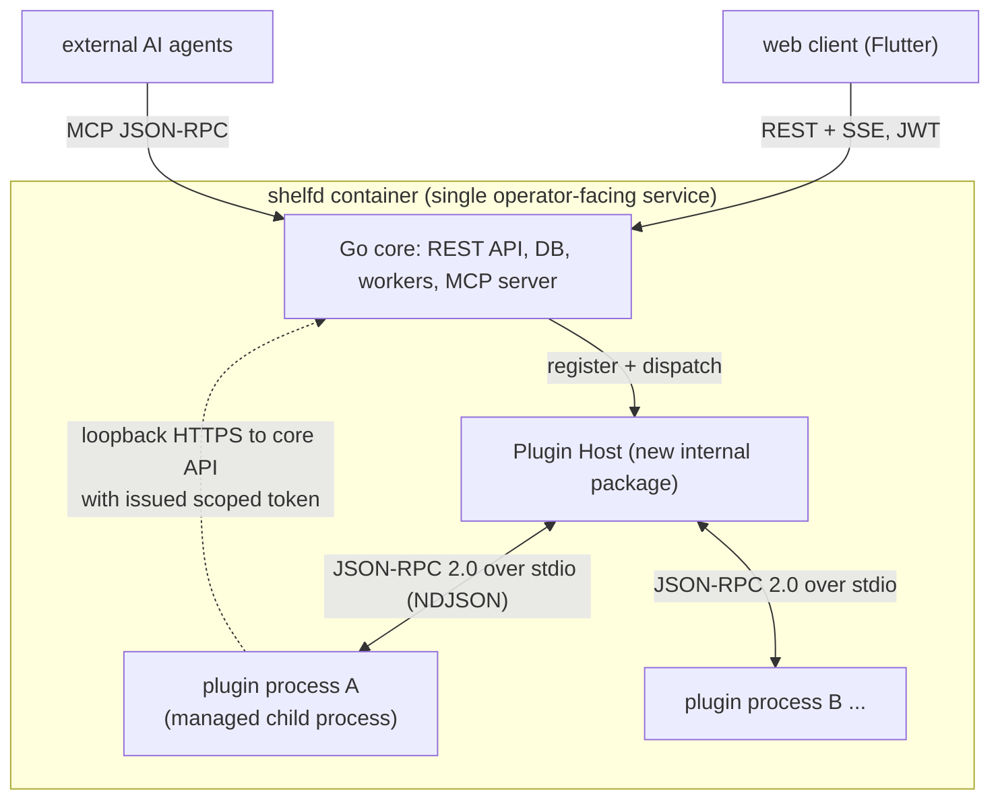

# Shelfd Plugin System — Architecture & Requirements Reference

**Purpose of this document**: Provide complete architectural context for an independent
reviewer evaluating the Shelfd plugin system — its requirements, trust model,
security properties, and operational constraints.

---

## 1. Product Context

Shelfd ("shelfd") is a self-hosted, single-container media library server:

- A Go daemon (single static binary, CGo for embedded SQLite + sqlite-vec vector index)
  targeting low-power NAS / homelab hardware. Idle footprint target: < 50 MB RAM.
- Serves a Flutter web/desktop client over REST (`/api/v1/*`, JWT bearer auth) and an
  MCP (Model Context Protocol) server over HTTP/SSE for external AI agents.
- Storage: one SQLite file (`/data/sqlite.db`) or PostgreSQL; book artifacts under a
  shared `/library` directory coexisting with other self-hosted media stacks
  (e.g., Audiobookshelf). Backup guarantee: copying `/data` is a complete backup.
- Deployment: single Docker container, operator-managed configuration file
  (`config.yaml` + `SHELFD_*` env overrides), PUID/PGID user mapping for shared mounts.

Existing in-process integrations that motivate this work (Yoto, NotebookLM, metadata
providers) are hardcoded modules: each requires a config section, hand-wired HTTP
handlers, its own database table, and a full image rebuild to add or change one.

## 2. Requirements

The plugin system must allow third-party programs (potentially written in other
languages and runtimes) to extend Shelfd without modifying or rebuilding the core, while:

| # | Requirement |
|---|-------------|
| R1 | **Capability surfaces**: plugins can expose (a) agent-callable tools on the existing MCP endpoint, (b) user-triggered commands via REST, (c) real-time events onto the existing SSE stream, (d) per-user settings stored server-side. |
| R2 | **Lifecycle**: core owns plugin lifecycle — discovery at startup, supervised restart with backoff, graceful shutdown. A misbehaving plugin must not crash or hang the daemon. |
| R3 | **Single-container identity**: default deployment remains one operator-facing service on one port. Plugins add no new exposed ports. |
| R4 | **Security parity**: plugins authenticate against the same auth model as first-party code (existing JWT users + SHA-256-hashed API tokens); secrets encrypted at rest; no secret material in process environment variables. |
| R5 | **Backup compatibility**: all plugin-owned state lives under `/data` so the existing single-file backup guarantee holds. |
| R6 | **Default image unchanged**: the minimal Go-only runtime image is unaffected; plugin support is inert when no plugins are installed. Runtime dependencies for specific plugins (e.g., a JS runtime) ship in an opt-in alternate image variant. |
| R7 | **Multi-user**: Shelfd is multi-account; every plugin invocation carries the invoking user's identity, and per-user plugin configuration is isolated between users. |
| R8 | **Extensible isolation**: the host↔plugin contract must allow tightening isolation later (e.g., plugin in a separate container speaking the same protocol over loopback HTTP) without changing the protocol. |

## 3. Host Architecture (Shelfd core)

### 3.1 Plugin layout & manifest

* Plugins live as directories under `plugins.dir` (default `/data/plugins`, host-mountable;
  no rebuild or image change required to install).
* Each plugin directory contains a `plugin.json` manifest declaring:
  - identity (`name` `^[a-z][a-z0-9_-]{1,32}$`, semver `version`, display name, description),
  - entrypoint: command + explicit argv + working dir (resolved on `PATH`; executed with
    `exec.CommandContext`, **no shell interpretation**),
  - runtime expectations (runtime family + minimum version),
  - capabilities used (`tools`, `commands`, `events`),
  - declarative permissions (intended network egress domains, library read/write intent) —
    surfaced in the UI and logs; **not enforced by the host** (see §5),
  - JSON Schema for its per-user configuration (rendered as a generic form in the web client;
    unsupported schema constructs degrade to raw-JSON editing).
* Invalid manifests are logged and skipped; core startup never fails because of a plugin.

### 3.2 Transport & protocol

* **Wire format**: JSON-RPC 2.0, newline-delimited (NDJSON) over the child process's
  stdin/stdout. Stderr is captured by the host and mirrored to structured logs.
  No network transport in v1 (the stdio choice exists precisely to keep R3; the dispatcher
  treats a plugin as `{request} → {response}` under a context deadline so an HTTP transport
  can be substituted later per R8).
* **Handshake**: host sends `initialize {protocol_version, shelfd_version, data_dir}`;
  plugin replies within 30 s with identity + declared tool/command definitions. Failure ⇒
  `unhealthy`, logged, retried.
* **Lifecycle**: host spawns at daemon start for each enabled plugin; restart-on-exit with
  exponential backoff (1 s → 60 s cap, 5 consecutive failures parks it as `unhealthy`);
  `shutdown` request on stop/disable with a 5 s grace period before forced termination.
* **Invocation** (host → plugin), each carrying the invoking user id:
  - `tools/call {name, arguments, user_id}` — MCP tool invocation (originating from external agents),
  - `commands/invoke {command, args, user_id}` — user action via REST/web client,
  - `config/update {user_id, config}` notification — push of that user's decrypted configuration.
* **Plugin → host notifications**: `event {name, data, user_id?}` (forwarded to the SSE
  stream as type `plugin_event`, payload capped at 64 KB), `progress`, `log`.
* **Environment provided to child (non-secret only)**: `SHELFD_API_BASE`
  (`http://127.0.0.1:<core port>`), `SHELFD_PLUGIN_TOKEN` (see §4),
  `SHELFD_DATA_DIR=/data/plugins/<name>` (persistent scratch under `/data`).

### 3.3 Aggregation into existing surfaces (no parallel systems)

| Plugin capability | Shelfd surface | Mechanism |
|---|---|---|
| Tools | the **single existing MCP endpoint** | tool definitions merged at startup under `{plugin}_{tool}` names; dispatch resolves the invoking user from the MCP session's API token (tokens are already per-user) |
| Commands | REST, behind existing JWT middleware | `POST /api/v1/plugins/{name}/commands/{command}` → `commands/invoke` |
| Events | existing SSE stream | re-published by host as `plugin_event` with plugin name + event name in the payload |
| Status/management | REST | `GET /api/v1/plugins`, `GET /api/v1/plugins/{name}` (state + log tail), `PUT/GET /api/v1/plugins/{name}/config`, enable/disable endpoints |

The web client renders all of this generically (manifest-driven forms and command buttons);
no per-plugin client code is required in v1.

## 4. Data & Secrets Model

* **Per-user plugin configuration** (new table): one row per `(user_id, plugin_name)`
  holding a JSON config blob. Secrets within it are encrypted at rest:
  AES-256-GCM, key = HKDF-SHA-256 derived from the server's `jwt_secret`
  (auto-generated on first boot and persisted in `/data`) with plugin-name info string.
  Decrypted values reach the plugin **only** via the `config/update` RPC — never via env vars
  (which leak through `/proc` and crash dumps).
* **Plugin API token**: at daemon start the core mints one API-token row per enabled plugin
  (`plugin:<name>`), stored exactly like existing user tokens (SHA-256 hash, constant-time
  compare). The plaintext is delivered to the child once at spawn. Plugins use it against
  `SHELFD_API_BASE` for any core capability they need (e.g., library queries, content upload)
  — i.e., plugins interact with the core through the same authenticated API that external
  clients use.
* **Scratch state**: plugin-owned working files live under `/data/plugins/<name>`; persistence
  semantics (e.g., credential/session file lifetimes) are the plugin's responsibility; the
  host guarantees only durability and backup inclusion.
* Consequences: rotating `jwt_secret` invalidates stored plugin secrets (re-entry required);
  deleting a user cascades their plugin configs; `/data` backup/restore round-trips everything.

## 5. Trust & Security Model (explicit non-goals included)

* **Trust model**: the operator installs plugin directories into their own container, the same
  trust relationship as choosing which software image to run. v1 applies **no sandboxing**:
  no process isolation, seccomp, namespaces, or network egress enforcement. Manifest
  permission fields are **advisory** (UI disclosure + logging) only. This is stated in the
  user-facing docs as a known limitation.
* What the host *does* enforce: manifest validation (name charset, semver, entrypoint
  resolution), no-shell argv execution, per-plugin data directory scoping, secret handling per
  §4, invocation auth (all REST routes behind existing JWT middleware; MCP dispatch bound to
  token identity), payload size caps on events, restart containment (§3.2).
* Core content-safety controls that already exist and apply to anything entering through the
  API — including uploads performed by plugins via their token — remain unchanged: archive
  path-traversal (Zip Slip) sanitization on content ingestion, parameterized queries only,
  SSRF validation for operator-supplied URLs.
* The web client is a browser SPA talking only to the core origin; it never communicates with
  plugin processes directly.

## 6. Operational & Deployment Constraints

* Default image: unchanged (Go-only, minimal base). Plugin support code is inert without a
  populated `plugins.dir`.
* Optional runtime variant image adds interpreter(s) + system dependencies required by
  particular plugins (e.g., a JS runtime and its system libraries); installing a plugin then
  requires only mounting/copying its directory, not rebuilding the image.
* Everything plugin-owned is under `/data` (R5); no plugin state may live outside it for the
  backup guarantee to hold — enforced by convention + manifest/docs, not technically.
* Multi-account deployments: two users invoking the same plugin concurrently are serialized
  per-process by the plugin itself; the host enforces nothing beyond single-instance-per-plugin.
* Logging: plugin stderr and RPC traffic are logged under structured keys
  (`component=plugin.<name>`); secrets must never appear in log output (host redacts config
  payloads; plugins contractually excluded from logging received configs).

## 7. Compatibility Notes for Reviewers

* The wire protocol is deliberately congruent with MCP JSON-RPC conventions (initialize
  handshake, tool definitions, notifications) because the core already implements that
  protocol natively; the host acts as an MCP-style *client* to plugins.
* Database backend is pluggable (SQLite default, PostgreSQL supported); the new
  `plugin_configs` table follows the existing migration framework and cascades on user delete.
* The core process model is supervisor-lite (manual goroutine lifecycle in `main`, workers
  with start/stop); the plugin host mirrors that pattern rather than introducing a new
  orchestration layer.

## 8. Scope Statement

This document describes **only the Shelfd host, protocol, and integration surfaces**. It is
deliberately neutral with respect to any particular plugin's functionality. The conduct of an
installed plugin — what data it processes on behalf of users, which external services or
content sources it interacts with, and the legal position of those interactions under the
applicable laws, licenses, and terms of service — is **outside the scope of this document**
and must be assessed separately against each plugin's own behavior and documentation. A
legality finding about the host architecture described here does not extend to any specific
plugin installed into it.
