# Shelfd UI/UX Redesign ("The Tactile Scriptorium") — Before & After Visual Gallery

This directory contains the 12-shot **Before (`HEAD` `603eb7e`)** vs. **After ("The Tactile Scriptorium" Redesign)** visual comparison gallery and side-by-side composites captured at `1440 × 900` desktop viewport resolution.

## Directory Layout

- `before/` — 12 screenshots (`1440×900`) captured against `HEAD` (`603eb7e`) demonstrating the pre-redesign UI ("scatter-brained cluster" of hardcoded `#F9F9F8` light surfaces, `#EAEAEA` 1px borders, broken Sepia/Dark theme propagation, flat book covers, proportional numerals, clashing `#7C3AED` purple icons, missing desktop `Auto-Fill` / `Publisher` / `Language` fields, and light-only OAuth consent page).
- `after/` — 12 screenshots (`1440×900`) captured against the redesigned "Tactile Scriptorium" working tree (`ShelfdColors` theme extension across **Bone**, **Sepia**, and **Dark Walnut**, `Newsreader` + `Work Sans` + `JetBrains Mono` tabular typography, `TactileBookCover` 3D spine creases & series stack plates, Nocturnal Obsidian & Warm Amber Audiobook Studio, clickable bookmarks, archival RAG citations, desktop `_MetadataInspector` parity, and dark-mode-aware Go OAuth 2.0 consent page).
- `comparisons/` — 12 deterministic side-by-side comparison composites (`2920×980`) pairing `before/<id>.png` (left) with `after/<id>.png` (right).
- `before_missing_covers.png` & `after_fixed_covers.png` — Preserved historical screenshots from earlier cover-extraction work.

---

## Complete 12-Shot Before vs. After Matrix

| # | Shot ID | View & Theme Mode | Before (`HEAD` `603eb7e`) | After ("The Tactile Scriptorium") | Side-by-Side Composite (`2920×980`) |
|---|---|---|---|---|---|
| 01 | `01_library_catalog_bone` | `/books` (`Bone` — Warm Parchment) | [`before/01_library_catalog_bone.png`](before/01_library_catalog_bone.png) | [`after/01_library_catalog_bone.png`](after/01_library_catalog_bone.png) | [`comparisons/01_library_catalog_bone_comparison.png`](comparisons/01_library_catalog_bone_comparison.png) |
| 02 | `02_library_catalog_sepia` | `/books` (`Sepia` — Archival Vellum) | [`before/02_library_catalog_sepia.png`](before/02_library_catalog_sepia.png) | [`after/02_library_catalog_sepia.png`](after/02_library_catalog_sepia.png) | [`comparisons/02_library_catalog_sepia_comparison.png`](comparisons/02_library_catalog_sepia_comparison.png) |
| 03 | `03_library_catalog_dark` | `/books` (`Dark` — Warm Dark Walnut) | [`before/03_library_catalog_dark.png`](before/03_library_catalog_dark.png) | [`after/03_library_catalog_dark.png`](after/03_library_catalog_dark.png) | [`comparisons/03_library_catalog_dark_comparison.png`](comparisons/03_library_catalog_dark_comparison.png) |
| 04 | `04_book_detail_overview_bone` | `/books/:id` Overview, Specs & TOC (`Bone`) | [`before/04_book_detail_overview_bone.png`](before/04_book_detail_overview_bone.png) | [`after/04_book_detail_overview_bone.png`](after/04_book_detail_overview_bone.png) | [`comparisons/04_book_detail_overview_bone_comparison.png`](comparisons/04_book_detail_overview_bone_comparison.png) |
| 05 | `05_book_detail_bookmarks_rag_dark` | `/books/:id` Clickable Bookmarks & RAG Chat (`Dark`) | [`before/05_book_detail_bookmarks_rag_dark.png`](before/05_book_detail_bookmarks_rag_dark.png) | [`after/05_book_detail_bookmarks_rag_dark.png`](after/05_book_detail_bookmarks_rag_dark.png) | [`comparisons/05_book_detail_bookmarks_rag_dark_comparison.png`](comparisons/05_book_detail_bookmarks_rag_dark_comparison.png) |
| 06 | `06_reader_toc_typography_dark` | `/books/:id/read` TOC Drawer & Typography Sheet (`Dark`) | [`before/06_reader_toc_typography_dark.png`](before/06_reader_toc_typography_dark.png) | [`after/06_reader_toc_typography_dark.png`](after/06_reader_toc_typography_dark.png) | [`comparisons/06_reader_toc_typography_dark_comparison.png`](comparisons/06_reader_toc_typography_dark_comparison.png) |
| 07 | `07_reader_highlights_sepia` | `/books/:id/read` Highlights & Callout Toolbar (`Sepia`) | [`before/07_reader_highlights_sepia.png`](before/07_reader_highlights_sepia.png) | [`after/07_reader_highlights_sepia.png`](after/07_reader_highlights_sepia.png) | [`comparisons/07_reader_highlights_sepia_comparison.png`](comparisons/07_reader_highlights_sepia_comparison.png) |
| 08 | `08_audiobook_studio_player` | `/books/:id/listen` Audiobook Studio (`Obsidian`) | [`before/08_audiobook_studio_player.png`](before/08_audiobook_studio_player.png) | [`after/08_audiobook_studio_player.png`](after/08_audiobook_studio_player.png) | [`comparisons/08_audiobook_studio_player_comparison.png`](comparisons/08_audiobook_studio_player_comparison.png) |
| 09 | `09_uploads_inspector_desktop` | `/uploads` Staged Queue & Desktop Metadata Inspector | [`before/09_uploads_inspector_desktop.png`](before/09_uploads_inspector_desktop.png) | [`after/09_uploads_inspector_desktop.png`](after/09_uploads_inspector_desktop.png) | [`comparisons/09_uploads_inspector_desktop_comparison.png`](comparisons/09_uploads_inspector_desktop_comparison.png) |
| 10 | `10_semantic_search_results` | `/search` Semantic Passage Citations (`Bone`) | [`before/10_semantic_search_results.png`](before/10_semantic_search_results.png) | [`after/10_semantic_search_results.png`](after/10_semantic_search_results.png) | [`comparisons/10_semantic_search_results_comparison.png`](comparisons/10_semantic_search_results_comparison.png) |
| 11 | `11_oauth_consent_light` | `/oauth/authorize` Live Go Server Consent (`Light`) | [`before/11_oauth_consent_light.png`](before/11_oauth_consent_light.png) | [`after/11_oauth_consent_light.png`](after/11_oauth_consent_light.png) | [`comparisons/11_oauth_consent_light_comparison.png`](comparisons/11_oauth_consent_light_comparison.png) |
| 12 | `12_oauth_consent_dark` | `/oauth/authorize` Live Go Server Consent (`Dark`) | [`before/12_oauth_consent_dark.png`](before/12_oauth_consent_dark.png) | [`after/12_oauth_consent_dark.png`](after/12_oauth_consent_dark.png) | [`comparisons/12_oauth_consent_dark_comparison.png`](comparisons/12_oauth_consent_dark_comparison.png) |

---

## Embedded Side-by-Side Comparisons

### 01. Library Catalog — Bone (`#FBF9F4` Warm Parchment & `#8E4A26` Burnt Sienna)
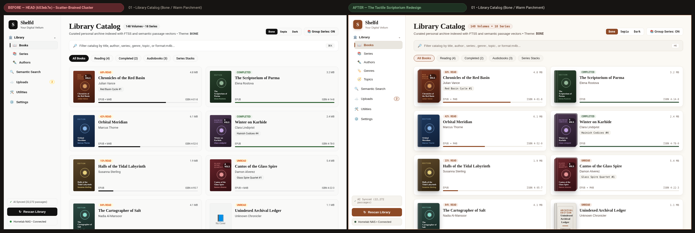

### 02. Library Catalog — Sepia (`#F4ECD8` Archival Vellum Theme Propagation Fix)
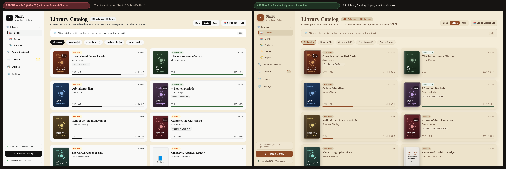

### 03. Library Catalog — Dark (`#161412` Warm Dark Walnut Theme Propagation Fix)
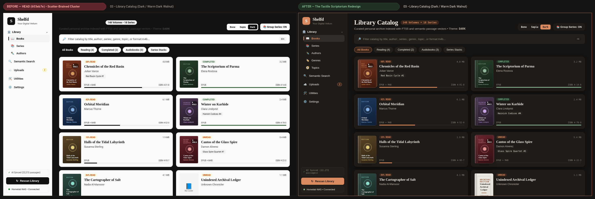

### 04. Book Detail Showcase — 3D Spine-Lit Cover, Monospace Specs & TOC
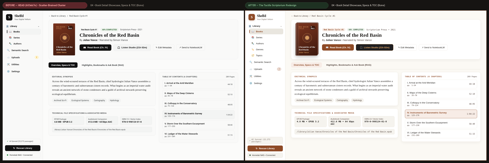

### 05. Book Detail Annotations — Clickable Bookmarks & Archival RAG Chat (Dark Mode)
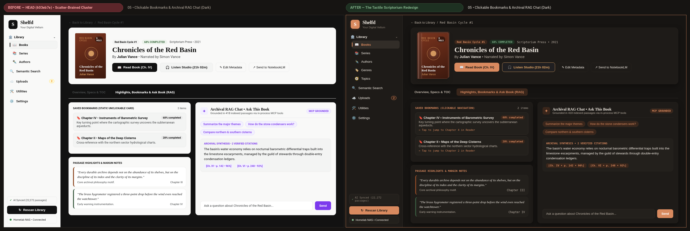

### 06. EPUB Reader — Dark Mode TOC Drawer (`selectedTileColor` Fix) & Typography Sheet
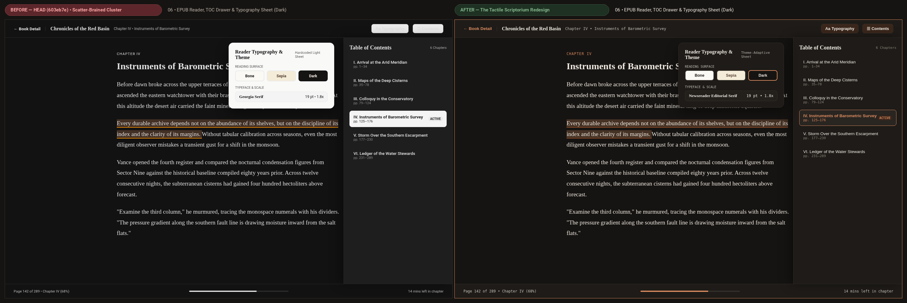

### 07. EPUB Reader — Sepia Archival Vellum & Highlight Callout Toolbar
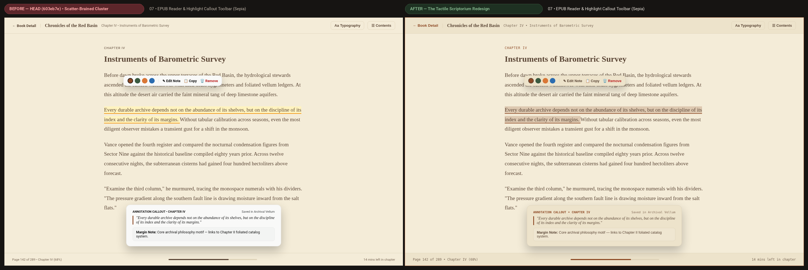

### 08. Audiobook Studio Player — Nocturnal Obsidian, 14px Sleeve Crease & Tabular Timestamps
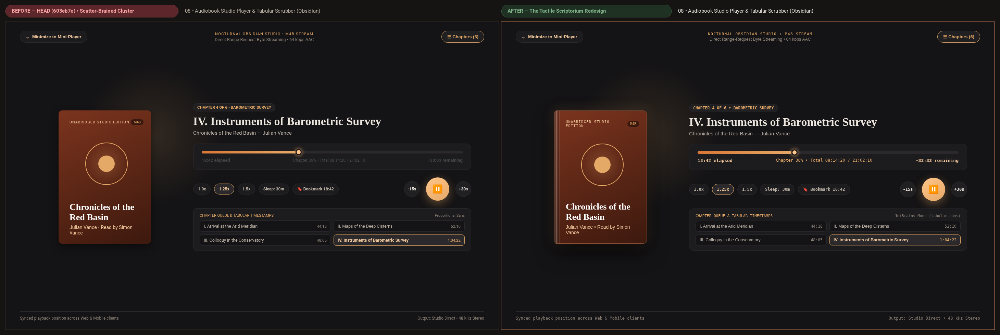

### 09. Uploads & Ingestion Workspace — Desktop `Auto-Fill`, `Publisher` & `Language` Parity
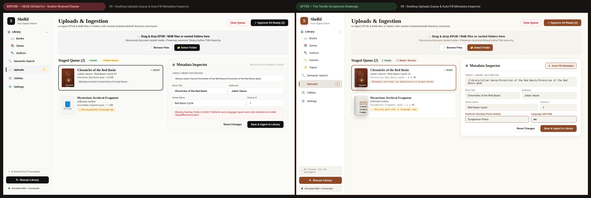

### 10. Semantic Passage Search — Burnt Sienna Citation Cards & `TactileBookCover` Thumbnails
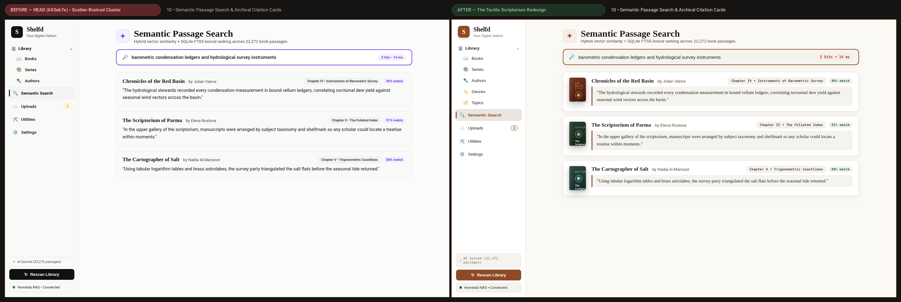

### 11. Go Backend OAuth 2.0 Consent (`/oauth/authorize`) — Light Mode
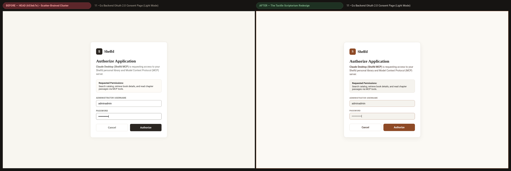

### 12. Go Backend OAuth 2.0 Consent (`/oauth/authorize`) — Dark Mode (`prefers-color-scheme: dark`)
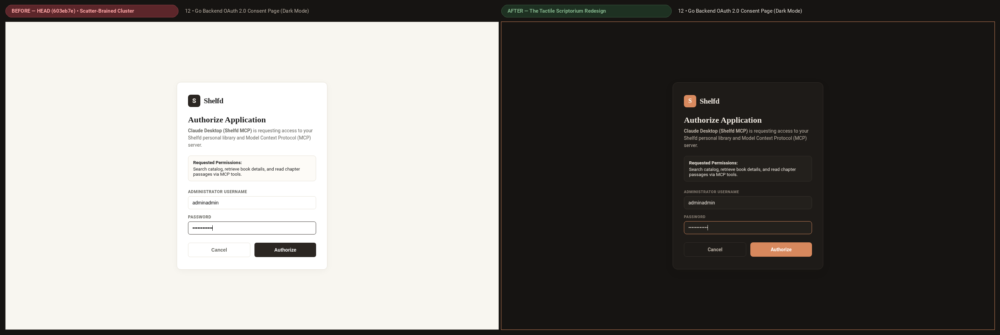
